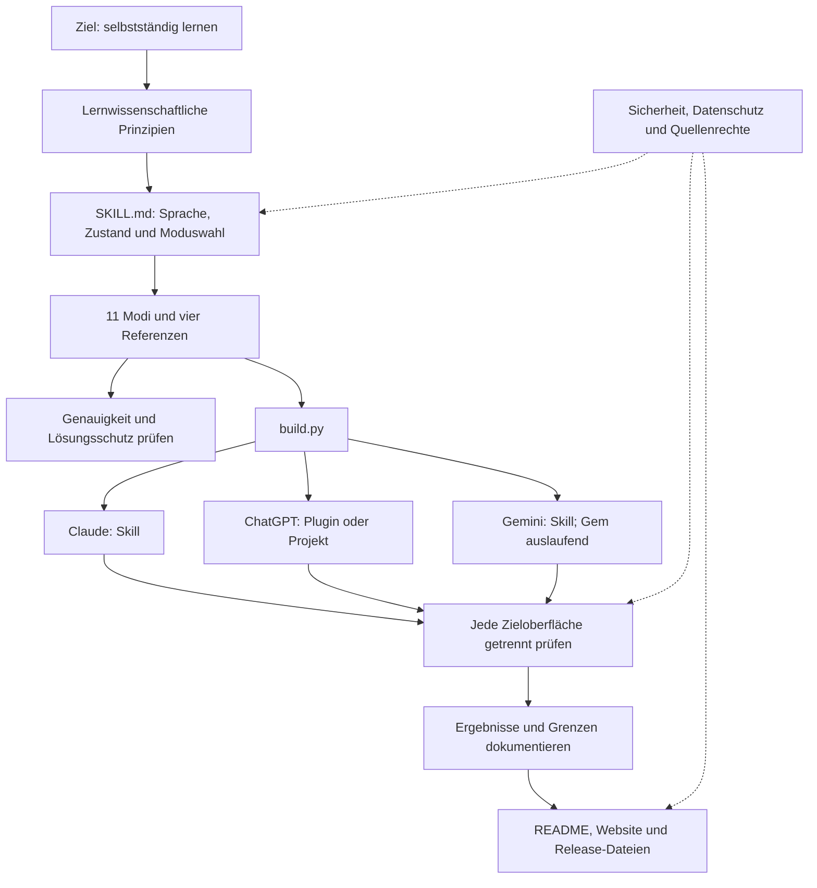

# Tutor – von der Idee zur Anwendung

> [!abstract] Hier beginnen
> Dieser deutschsprachige Obsidian-Vault erklärt den Lern-Tutor, seine Gestaltung, Dateien und Prüfverfahren. Nach dem Klonen den Unterordner `Obsidian-tutor` in Obsidian als Vault öffnen und mit dieser Seite beginnen. Community-Plugins und ein Veröffentlichungsabonnement sind nicht erforderlich.

## Einen Einstieg wählen

| Ich möchte … | Lesepfad |
|---|---|
| die Idee verstehen | [[01 Ziel]] → [[02 Funktionsweise]] → [[06 Modi]] |
| den Skill bauen oder ändern | [[03 Umsetzung]] → [[05 Skills und Werkzeuge]] → [[08 Repository-Aufbau]] |
| einen Fehler beheben | [[17 Fehlerdiagnose und Reparatur]] → [[18 Bauanleitung]] → [[12 Abnahmeplan]] |
| Entscheidungen aus früheren Chats nachvollziehen | [[19 Entscheidungen und Gesprächskontext]] → [[13 Quellen und Nachweise]] |
| ihn einrichten und prüfen | [[07 Plattformen]] → [[12 Abnahmeplan]] |
| die Forschungsgrundlage prüfen | [[04 Wissenschaftliche Grundlagen]] → [[13 Quellen und Nachweise]] |
| das Projekt für Besucher aufbereiten | [[09 Besucher und Inhalte]] → [[10 Sicherheit und Datenschutz]] → [[11 Website]] |
| offene Arbeiten verfolgen | [[14 Arbeitsplan]] → [[15 ECC-Zuordnung]] → [[16 Prüfergebnis]] |

## Gesamtüberblick

## Verschiebbare Wissenslandkarte

![[Tutor-Landkarte.canvas]]

Ein Doppelklick auf eine Karte öffnet die zugehörige Notiz. Die Graph-Ansicht zeigt die Verbindungen zwischen den internen Links.

> [!warning] Projektstatus
> Dokumentiert ist der Stand bei Commit `b2fdc739823c838de8a1f3a6d0b3c8a8ddb3db62` (`main`, Vorabversion `v0.3.0-rc.3`) als Produktbasis; Dokumentationsänderungen dieser Fassung kommen hinzu. Die Recherche vom 2026-10-16 bezog sich auf `921409f2f7e0ccbe54e962ec8218024f74bc3fab`. Vollständige Kompatibilität und Lernwirksamkeit sind nicht nachgewiesen. Eine Plattformanleitung oder ein erfolgreicher Paketbau ersetzt keine Abnahme. Siehe [[07 Plattformen]] und [[12 Abnahmeplan]].

## Aktueller Nachweisstand

| Gegenstand | Ergebnis der Aktualisierung vom 2026-10-27 |
|---|---|
| Dokumentation | 20 Fachnotizen mit deutschen Erläuterungen; Fehlerdiagnose, Bauanleitung und Entscheidungsverlauf ergänzt. |
| Wissenslandkarte | Canvas mit 20 Dateikarten und fünf Themengruppen; zusätzlich Mermaid-Abläufe und Graph-Verbindungen. |
| Lokale Prüfung | 22 Repository-Strukturtests bestanden; elf Modi; alle 43 Quellhashes stimmen mit dem eingecheckten Stand überein. |
| GitHub-Recherche zur Produktbasis | Öffentlich; `main` und lokaler Basiscommit gleich; Schutzkennzeichen gesetzt; CI für diesen Basiscommit erfolgreich. |
| Verteilung und Website | Aktuell `v0.3.0-rc.3` („Latest“, fünf Assets), vorher `v0.2.1`; Website lädt `v0.3.0-rc.3` herunter. |
| Plattformverhalten | Teilversuche vorhanden; vollständige Abnahme von Claude, ChatGPT und Gemini weiterhin offen. |

Nachweise und genaue Grenzen: [[13 Quellen und Nachweise]] und [[16 Prüfergebnis]].

## Den Vault verwenden

In Obsidian „Ordner als Vault öffnen“ wählen und `Obsidian-tutor` angeben. In dieser Startseite einen Lesepfad wählen; `Tutor-Landkarte.canvas` öffnet die verschiebbaren Dateikarten. Wikilinks verbinden die Notizen auch in der Graph-Ansicht. Die Python-Prüfung liest die Quellen aus der übergeordneten Repositorywurzel. Den gesamten Checkout behalten; beim Kopieren allein dieses Ordners bleiben die Artikel lesbar, die Quellen lassen sich dort ohne Repository nicht erneut prüfen. Wikilinks und Canvas sind für Obsidian bestimmt; GitHub stellt diese Formate nicht vollständig als Navigation dar.

Diese für GitHub aufbereitete Fassung enthält Fachnotizen, Canvas und Prüfwerkzeug; persönliche Obsidian-Einstellungen sind ausgeschlossen. Quellenprüfung: 2026-10-16, Zeitzone Europe/Berlin. Die Wissensbasis im Repository und die bestehende Produktwebsite sind getrennte Einstiege.

## Änderung für rc.3 (17.10.2026)

Die Schutzentscheidung [#34](https://github.com/Sae-l/tutor/issues/34) ist in der gemeinsamen Quelle umgesetzt: Schutz aller Medien und Nachweise, lokale Check-Korrektur, begrenzte Graphfreigabe und eindeutiger Abruf. Zwölf neue Fälle in `tests/akzeptanz.md` sind noch nicht nativ geprüft. Die alten Testergebnisse und Live-Abfragen oben bleiben Nachweise ihres damaligen Stands; #32 und die offenen Plattform-/Gateentscheidungen bleiben offen.
