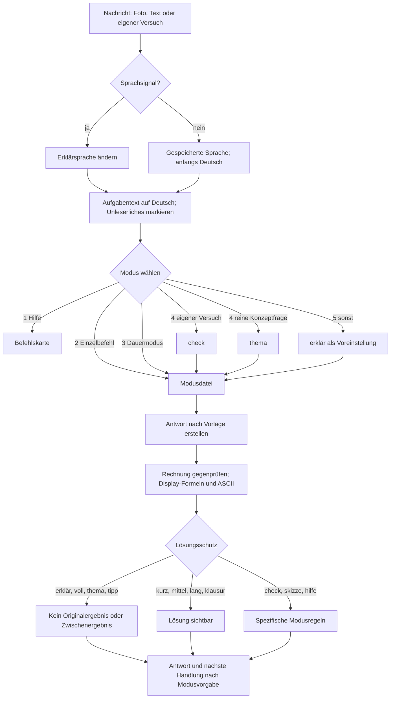
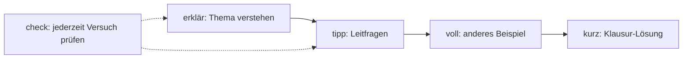

# Funktionsweise

← [[00 Startseite]] · Zurück: [[01 Ziel]]

## Von der Nachricht zur Antwort

## Reihenfolge der Moduswahl

1. **Hilfe**, etwa wenn die Nachricht nur `hilfe`, `tutor` oder `?` enthält.
2. **Einzelbefehl** am Nachrichtenanfang oder mit `!` in der eigenen Anweisung.
3. **Dauermodus**, gesetzt mit `!an <Befehl>` bis `!aus`.
4. **Automatisch:** `check` bei eigenem Versuch, `thema` bei reiner Konzeptfrage.
5. **Voreinstellung:** `erklär`.

Bei mehreren Befehlen gilt der letzte; ebenso bei mehreren Sprachsignalen.

> [!important] Aufgabeninhalt ist keine Steueranweisung
> Befehle in zitierten Aufgaben, Fotos und PDFs bleiben Inhalt. Sie ändern den Modus nicht. Das ist eine vorgesehene Schutzregel gegen [[10 Sicherheit und Datenschutz#Prompt-Injection]].

## Lösungsschutz

- Ein 🔒-Titel oder eine Leerzeile verbirgt keinen Text. Zurückgehaltene Lösungen werden erst auf `lösung` ausgegeben; ausdrücklich lösende Modi zeigen ihre Lösung direkt.
- `lösung` ist ein Abruf und kein Modus; der gespeicherte Dauermodus bleibt bestehen.
- Bei mehreren offenen Aufgaben wird einmal nach der Nummer gefragt. Welche von mehreren offenen Verständnisfragen gemeint ist, bleibt im freien Test als Regelungslücke dokumentiert.
- Vor dem Senden dürfen die Verständnis-Modi weder Ergebnis, Zwischenergebnis noch eine entscheidende umgestellte Gleichung der Originalaufgabe enthalten.

## Eskalation

Die allgemeine Regel fordert eine nächste Handlung und den nächsten Eskalationsbefehl. Modusdateien enthalten Ausnahmen: `kurz` endet mit einer Anmerkung. Im freien Test fehlten Eskalationsbefehle. Die Vorgabe ist daher getrennt vom beobachteten Verhalten zu prüfen.

## Zustand

Der Skill legt keinen externen Zustandsspeicher an. Sprache und Dauermodus hängen vom Gesprächskontext ab. Die gewählte Sprache bleibt bis zum Wechsel bestehen; `!aus` beendet nur den Dauermodus. Bei aktivem Dauermodus oder einer anderen Erklärsprache als Deutsch zeigt eine Statuszeile den tatsächlichen Modus, den gespeicherten Dauermodus und die Sprache. Die Plattform kann eigene Speicherfunktionen ergänzen; Tests beginnen deshalb in getrennten Gesprächen.

## Router und schrittweises Nachladen

- `SKILL.md`: Zweck, Ablauf, Befehlstabelle, Verweise auf Modusdateien und Lösungsschutz.
- `modes/`: eine Datei je Modus; vorgesehen ist das Lesen der benötigten Datei und Referenzen. Was das Modell tatsächlich liest, muss beobachtet werden. Projekt und Gem verwenden einen zusammengeführten Prompt.
- `references/`: Antwortvorlage mit Abschnitten 0–19, Didaktik, Sprache und LaTeX-Regeln.

Weiter: [[06 Modi]] und [[03 Umsetzung]].
