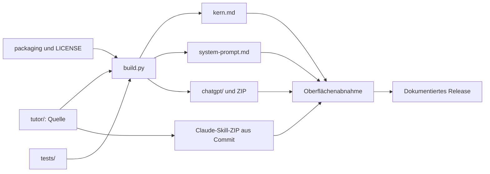

# Aufbau des GitHub-Repositorys

## Neue Prüfreferenzen

`tests/modi-v030.md` enthält selbst erstellte fachliche und verhaltensbezogene Abnahmefälle. `tests/test_fachreferenzen.py` kontrolliert vier Gruppen ihrer Sollwerte mit der Standardbibliothek. `tests/protokolle/2026-10-24-v030-audit.md` trennt technische Prüfungen, Review und nicht ausgeführte Modellläufe. Releaseänderungen: `docs/releases/v0.3.0-rc.1.md`.

← [[00 Startseite]] · [[03 Umsetzung]] · [[09 Besucher und Inhalte]]

Das lokale Remote verweist auf [Sae-l/tutor](https://github.com/Sae-l/tutor). Der GitHub-Connector bestätigt bei dieser Aktualisierung **öffentlich**, Default-Branch `main` und nicht archiviert. Die öffentliche Commit-API liefert für `main` denselben Commit wie lokal: `921409f2f7e0ccbe54e962ec8218024f74bc3fab`. `LICENSE` enthält lokal MIT. Die frühere Angabe „privat“ aus dem Audit vom 2026-10-14 ist überholt.

Die Branch-API meldet `protected: true`; Die Antwort nennt als Pflichtprüfungen `build-und-tests (ubuntu-latest)` und `build-und-tests (windows-latest)` mit `enforcement_level: non_admins`. Vollständige Schutzregeln und Umgehungsrechte wurden nicht geprüft. Die [CI für diesen Commit](https://github.com/Sae-l/tutor/actions/runs/38799637520) ist abgeschlossen und erfolgreich. Das belegt den Workflowlauf, keine Plattformabnahme. Die [Vorabversion v0.2.0-rc.2](https://github.com/Sae-l/tutor/releases/tag/v0.2.0-rc.2) enthält fünf Assets. Rohwerte und Abfragewege: [[Live-Nachweise.json|Live-Nachweise.json]].

## Tatsächliche Git-Wurzel

```text
tutor/                         ← Git-Wurzel im übergeordneten Arbeitsordner
├── README.md                  Einstieg für Besucher
├── LICENSE                    MIT
├── SECURITY.md                Sicherheitsregeln und Meldeweg
├── CONTRIBUTING.md            Entwicklung und Release-Gate
├── CHANGELOG.md                Versionsänderungen
├── GLOSSARY.md                 Verbindliche Begriffe
├── tutor/                     Skillquelle
│   ├── SKILL.md                Router und Kernabschnitte
│   ├── modes/                  Elf Modusdateien
│   └── references/             Vier gemeinsame Referenzen
├── kurse/                     Optionale Kurskontexte
├── .claude-plugin/marketplace.json  Claude-Code-Marketplace → dist/chatgpt/plugins/tutor
├── .agents/plugins/marketplace.json Codex-Marketplace → dist/chatgpt/plugins/tutor
├── packaging/                 Manifestquelle, Plugin-README und Logo
├── build.py
├── dist/                      Generierte Ausgaben
│   ├── kern.md
│   ├── system-prompt.md
│   ├── tutor-chatgpt.zip
│   └── chatgpt/                Marketplace, Plugin und Skill
├── tests/                     Struktur, Abnahme und bereinigte Protokolle
├── docs/
│   ├── index.html              Vorgesehene GitHub-Pages-Website
│   ├── fonts/                  Lokale Schriften und Lizenzen
│   ├── .nojekyll
│   ├── KONZEPT.md
│   ├── CHATGPT.md
│   ├── planung/                Datierte Entscheidungen
│   └── agents/                 Arbeitsanweisungen für Agenten
├── .github/                   CI, Dependabot und Vorlagen
├── .gitattributes              Einheitliche Zeilenenden
├── Obsidian-tutor/            Deutsche Wissensbasis, Canvas und lesende Prüfung
└── .gitignore                 Lokaler Ausschluss, keine Geheimhaltung
```

## Dateifluss



## Dokumentation und Laufzeit trennen

`Obsidian-tutor/` liegt innerhalb des Repositorys und wird mitversioniert. Der Ordner gehört weder zur Skillquelle noch zu den erzeugten Pluginpaketen. Alle Markdown-Notizen und die Canvas-Datei bleiben über relative Wikilinks verbunden.

Persönliche `.obsidian/`-Einstellungen, unveröffentlichte Testgespräche, Kursbilder, lokale Auditkopien und Werkzeugzustände gehören nicht in diesen Dokumentationsordner. Der private Arbeitsvault bleibt unabhängig von der veröffentlichten Fassung. Siehe [[09 Besucher und Inhalte]].
