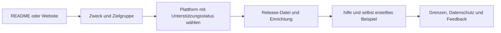

# Besucher und Inhalte

← [[00 Startseite]] · [[10 Sicherheit und Datenschutz]] · [[11 Website]]

## Weg eines Besuchers

## Vorgeschlagene Inhaltsaufteilung

| Inhalt | Hauptwebsite | Repository oder Dokumentation | Lokal oder privat |
|---|---|---|---|
| Ziel, Zielgruppe, eigenes Beispiel und Modi | Kurz und deutlich | Ausführlich und überprüfbar | — |
| Release-Paket, Version und Hash | Verlässlicher direkter Download | Release und Buildbeschreibung | Nicht freigegebene Entwürfe lokal |
| Status von Claude, ChatGPT und Gemini | Neben dem Einstieg sichtbar | Vollständige Nachweismatrix | — |
| Skillquelle, Build und Tests | Entwicklerlink | Einsehbar | — |
| Studien und Aussagegrenzen | Zusammenfassung ohne Wirksamkeitsversprechen | Quellen und Erläuterungen | — |
| Sicherheit, Datenschutz und Lizenz | Gut auffindbare Links | Richtlinien | Vertrauliche Meldungen privat |
| Abnahmeprotokolle | Ergebnisübersicht | Bereinigte Fassung mit selbst erstellten Aufgaben | Unbearbeitetes Original privat |
| Gespräche, Namen, E-Mail und Noten | Nicht veröffentlichen | Nicht veröffentlichen | Nur bei Bedarf und mit Zustimmung begrenzt speichern |
| Vorlesungs-/Prüfungsbilder und Dozentenmaterial | Nur mit geklärten Rechten | Standardmäßig ausschließen | `referenzen/` lokal |
| Agentenzustand, Speicher und Gerätepfade | Kein Nutzen für den Einstieg | Ausschließen | `.claude/`, `.agents/`, `.claude-flow/`, `.agentic-qe/` |
| Obsidian-Arbeitszustand | Nicht veröffentlichen | Nicht für den Einstieg nötig | `.obsidian/workspace*.json`; Sync- und Kontoeinstellungen privat prüfen |
| Planungsverlauf | Einstieg nicht überladen | Bereinigte Auszüge bei Nutzen | Private Details lokal |

## Ausblenden ist kein Zugriffsschutz

Ein `
`-Block, ein entfernter Link, ein fehlender Menüeintrag, Obsidian-Kommentare `%%` oder `publish: false` machen eine in einem öffentlichen Repository gespeicherte Datei nicht geheim. Auch die Graph-Ansicht kann Notiznamen zeigen. Vertrauliches wird nicht veröffentlicht; der tatsächliche Speicherort benötigt passende Zugriffsrechte.

In einem offenen Quellprojekt sind Prompt- und Modusdateien nicht automatisch Geheimnisse. Der Lösungsschutz im Gespräch ist eine Lernregel und verhindert nicht das Lesen der Quellen auf GitHub.

## Vor einer Vault-Veröffentlichung

- [ ] Nur vorgesehene Artikel auswählen; Texte, Links, Anhänge, Properties und Canvas-Dateinamen prüfen.
- [ ] Gerätepfade und Gesprächslinks durch geeignete bereinigte Nachweise ersetzen.
- [ ] Testergebnisse nur der dokumentierten Version zuordnen; Commit und Hash erhalten.
- [ ] Anzahl der Modi und Tests sowie Plattformstatus zwischen README, Website und Vault abgleichen.
- [ ] Vorgemerkte Änderungen, Git-Verlauf und Pakete prüfen; `.gitignore` allein reicht nicht.

Dies ist eine Inhalts- und Veröffentlichungsrichtlinie. Die Repositorysichtbarkeit bleibt unverändert. Diese Fassung ist für die Veröffentlichung ausgewählt; persönliche Einstellungen und Gesprächsmetadaten sind ausgeschlossen.
