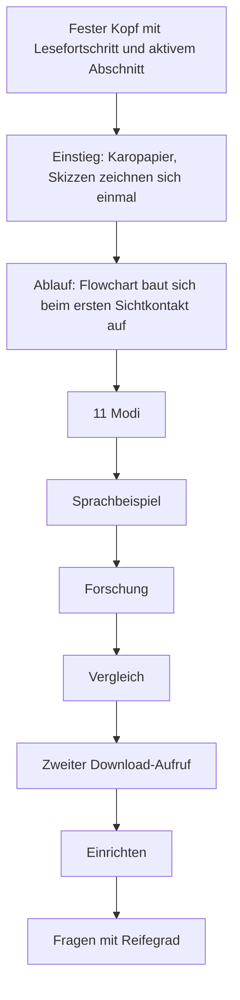

# Die Website

← [[00 Startseite]] · [[09 Besucher und Inhalte]]

Die README verweist auf die [Tutor-Website](https://sae-l.github.io/tutor/). Maßgebliche lokale Quelle ist `tutor/docs/index.html`, nicht die separate Kopie `landing/index.html`. `CLAUDE.md` beschreibt GitHub Pages aus `main` und `/docs`. Beim erneuten HTTPS-Abruf am 2026-10-16 antwortete die Website mit **HTTP 200**; der HTML-Text entspricht nach Vereinheitlichung von CRLF/LF der lokalen Quelle. Das bestätigt den ausgelieferten Text, nicht Darstellung oder Interaktion im Browser. Die Pages-Konfigurations-API antwortete ohne Anmeldung mit 404; daraus wird kein fehlendes Deployment abgeleitet.

## Zweck und Inhalte

Die statische Seite erklärt den Tutor und bietet Downloads. Sie betreibt keinen Chat und führt Tutor nicht im Browser aus. Das Lernen findet nach der Einrichtung auf einer KI-Plattform statt.

| Abschnitt der Quelle | Nutzen für Besucher |
|---|---|
| Einstieg und Download | Zweck, Zielgruppe (Studium allgemein) und Version; Downloadlink auf die aktuelle Version `v0.3.0-rc.3` (seit 2026-10-28, vorher `v0.2.1`); Kennzahlen 23 Arbeiten, 11 Modi, 6 Erklärsprachen, 0 € / MIT; Veröffentlichung separat prüfen. |
| Schrittweise Hilfe | Flowchart „Verstanden?“ mit den Wegen check sowie tipp → voll → kurz, darunter die vier Stufen als Liste und ein fest hinterlegtes Beispiel „Probier es aus“: die Autoaufgabe aus U12/U13 (aus der Ruhe in 8,0 s auf 24 m/s) mit `erklär`, `tipp`, `voll` (Bremsweg-Beispiel 160 m) und `kurz` (96 m), Formeln als MathML, Lösung nur unter `kurz`. |
| 11 Modi | Befehle vergleichen und auswählen. |
| Sprachbeispiel | Fest hinterlegtes Beispiel in de/ar/tr/fr/en/ur mit deutschen Fachbegriffen. |
| Forschung | 23 Arbeiten und 7 Metaanalysen aus [[13 Quellen und Nachweise]] und `docs/planung/`; Kestin et al. 2025 als Leitbefund (mehr als doppelter Lernzuwachs, 49 statt 60 Minuten; Volltext auf PMC am 2026-10-28 gelesen), Bastani et al. 2025 als Begründung des Lösungsschutzes, drei Effektgrößen (Wisniewski 2020, Bisra 2018, Barbieri 2023), sechs Prinzipien mit Tutor-Regel; die Seite spricht von belegten Prinzipien, nicht von einer nachgewiesenen Wirkung des Tutors. |
| Vergleich | Chat ohne Lernmodus, Lernmodi der Anbieter und Tutor in acht Zeilen; Stand Oktober 2026 nach Anbieterangaben, nicht gegen aktuelle Anbieterseiten geprüft. |
| Zweiter Aufruf | Download und Sprung zur Einrichtung nach dem Vergleich. |
| Einrichtung | Claude Skill und experimentelle ChatGPT-/Gemini-Wege, letztere eingeklappt; seit 2026-10-20 Gemini-Skill mit `tutor-skill.zip`, Gem als auslaufend gekennzeichnet. |
| Häufige Fragen | Zehn Fragen, zuerst aus Besuchersicht: Aufgaben und Fächer, Kosten, Handy, Kurspaket, ADHS-Gestaltung, Neuerungen in v0.3.0-rc.3; danach Fehlerhilfe, Formeldarstellung je Plattform und Aktualisierung. |
| Fußbereich | Marke mit PayPal-Unterstützung, GitHub (Quellcode, Probleme und Wünsche, Changelog, Bauweise statt früherem Abschnitt „Unter der Haube“, Wissensbasis), Über mich (LinkedIn, Instagram), Datenschutz; Abschlusszeile mit MIT-Lizenz und Version. |

## Gestaltung seit 2026-10-19

- Hell- und Dunkelmodus folgen der Systemeinstellung; Farben stehen als CSS-Variablen in `:root`, Inline-SVGs nutzen dieselben Variablen.
- Bewegung nur einmalig und nur mit `transform`, `opacity` und Strichlänge; keine Endlosschleifen. `prefers-reduced-motion` zeigt alles sofort und vollständig.
- Neu: Sprunglink zum Inhalt, Favicon als Daten-URI, Open-Graph-Angaben. Weiterhin keine externen Schriften oder Skripte.
- Die README zeigt eine 12-Sekunden-Animation (erklär → tipp → check, `docs/assets/hero-light.gif`, `hero-dark.gif`) und zwei Mermaid-Flowcharts. Quelle `docs/assets/hero/hero.html`, erzeugt mit `docs/assets/hero/render.mjs`; dasselbe Skript schreibt das Vorschaubild `hero-light.png` (og:image).
- Geprüft: lokale Darstellung in Chrome (hell, dunkel, reduzierte Bewegung, schmale Ansicht) und Strukturtests. Nicht geprüft: das veröffentlichte GitHub-Pages-Deployment.

## Technische Funktionsweise

- HTML, CSS und JavaScript in einer Seite; lokale WOFF2-Schriften und OFL-Lizenzen unter `docs/fonts/`.
- JavaScript wechselt vordefinierte Sprachbeispiele, setzt `lang` und für Arabisch/Urdu `dir` und erzeugt Fachbegriffstabellen mit DOM-Funktionen und `textContent`.
- Unter 768 px bleibt das Abschnittsmenü als wischbare Zeile sichtbar; die Vergleichstabelle bricht dort in drei schrumpfbare Spalten um. Lokal bei 320, 375, 820 und 1280 px ohne seitlichen Überlauf geprüft (2026-10-28), nicht auf echten Geräten.
- Kopierknöpfe verwenden `navigator.clipboard` und zeigen einen Fehlerzustand an. Elemente werden mit `IntersectionObserver` eingeblendet; dafür gibt es einen Ersatzpfad bei fehlender Unterstützung.
- Im geprüften Quelltext wurden keine `fetch`-Aufrufe, externen Trackingskripte oder Uploadformulare gefunden. Das ist eine Quelltextbeobachtung, kein Mitschnitt des tatsächlichen Netzwerkverkehrs. GitHub-Hosting und externe Links haben einen eigenen Datenschutzkontext.

## Dokumentierter Synchronisationsbedarf

In rc.3 nennt die Website **30 Modusfälle, 33 Grenzfälle und 12 Schutzregressionen**, verlinkt den öffentlichen Vault und bewahrt den Status „nicht abgenommen“. Die frühere Abweichung 32/33 ist damit in der Quelle korrigiert. Deployment und tatsächlich gelieferte Dateien separat prüfen; historische Live-Nachweise bleiben datiert.

## Website später ändern

1. `docs/index.html` als Quelle ändern; Deutsch als Besuchersprache und die vorhandenen Sprachbeispiele erhalten.
2. Version, Paketlinks, Moduszahl und Prüfstatus mit README und Protokollen abgleichen.
3. Mobilansicht, Tastaturbedienung, Kontrast, Kopieren, Links und RTL prüfen. Beim Sprachwechsel müssen deutsche Überschriften erhalten bleiben.
4. Nach dem Deployment die tatsächliche Website prüfen. Eine lokale Vorschau belegt kein erfolgreiches GitHub-Pages-Deployment.

Diese Notiz erklärt und bewertet die Quelle. Website und Deployment wurden durch die Vault-Aktualisierung nicht geändert. HTTP-Ergebnis und Vergleichshashes stehen in [[Live-Nachweise.json|Live-Nachweise.json]]; eine neue Browser-, Mobil- oder Barrierefreiheitsprüfung fand nicht statt.
