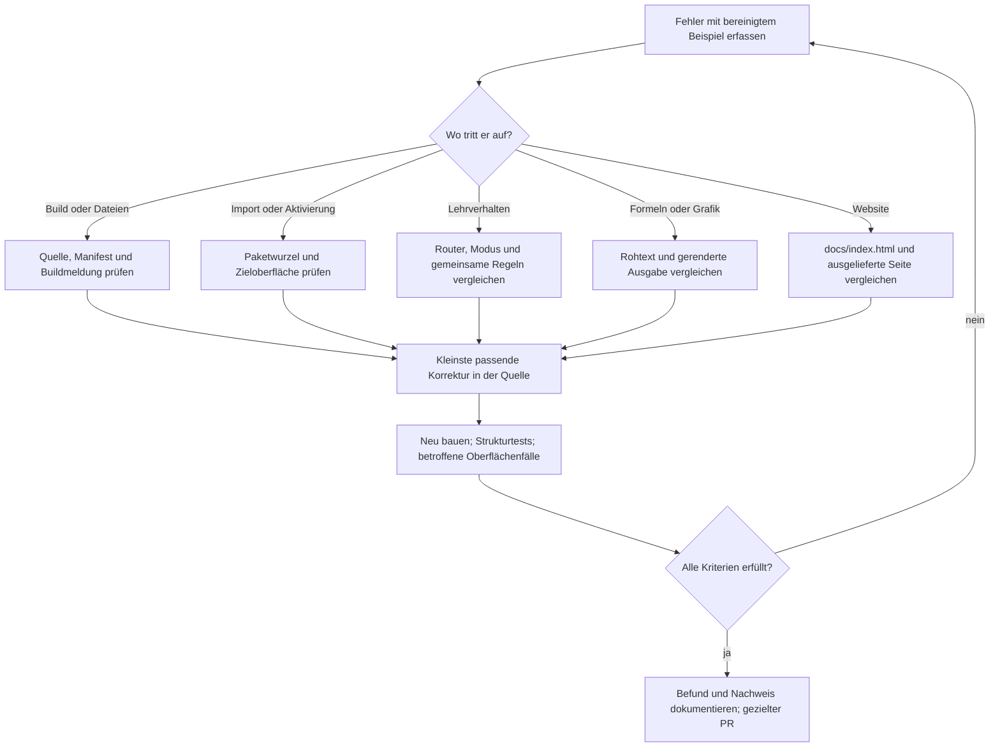

# Fehlerdiagnose und Reparatur

← [[00 Startseite]] · [[03 Umsetzung]] · [[12 Abnahmeplan]] · [[18 Bauanleitung]]

## Beim konkreten Fehler beginnen

Eine falsche Antwort, ein Importfehler und eine veraltete Website haben unterschiedliche Ursachen. Zuerst den genauen Eingang, die erwartete Ausgabe, die tatsächlich beobachtete Ausgabe und den installierten Stand festhalten. Für Beispiele eigene Aufgaben verwenden. Modell, Oberfläche, Version, Commit und Paket-SHA-256 gehören zum Befund.

## Symptome und zuständige Quellen

| Symptom | Zuerst prüfen | Reparatur und Nachweis |
|---|---|---|
| Build: „Moduldateien statt 11“ | Befehlstabelle in `tutor/SKILL.md`, doppelte Einträge, vorhandene `modes/*.md` | Eintrag und Dateiname abgleichen. Nur bei beabsichtigter Erweiterung Anzahl in Build, Tests, Hilfe und Dokumentation gemeinsam anpassen. |
| Build: fehlende Datei oder offener Verweis | Exakten Pfad der Meldung und Schreibweise unter `modes/` bzw. `references/` | Quellverweis korrigieren; keine Ersatzdatei nur zum Bestehen erzeugen. Build und Fehlertests wiederholen. |
| Kern über 4000 Zeichen | Kernmarkierungen im Router | Redundanz im Kern entfernen, ausführliche Regeln erhalten. Grenze ist intern; nicht mit einer zugesicherten Anbietergrenze begründen. |
| Import lehnt ZIP ab | Tatsächliche Archivliste, Zielplattform, `plugin.json` oder `SKILL.md` an der erwarteten Stelle | Passende Verpackung wählen. ChatGPT-Plugin und Skill-ZIP haben unterschiedliche Wurzeln; ob Gemini das Skill-ZIP mit `tutor/` an oberster Stelle annimmt, ist ungeprüft. Ein ZIP als Chat-Anhang ist kein Pluginimport. |
| Tutor startet nicht oder verwendet alte Regeln | Aktives Paket, doppelte Installationen, explizite Auswahl, Projektanweisungen und neues Gespräch | Erst den beabsichtigten Skill isoliert prüfen. Explizite und automatische Aktivierung getrennt protokollieren; keine automatische Aktivierung behaupten, nur weil `hilfe` beantwortet wurde. |
| Lösung erscheint in `tipp`, `erklär`, `thema` oder `voll` | Router-Schutz, Modusdatei und gemeinsame Didaktikregeln | Ursächlichen Regelkonflikt korrigieren. Bei Router-/Referenzänderung vollständige Matrix wiederholen; ein Schlosszeichen verbirgt nichts. |
| Falscher Modus oder Sprachwechsel | Reihenfolge Hilfe → Einzelbefehl → Dauermodus → automatische Wahl; Sprachsignal vor Befehlsauswertung | Text in Fotos/Zitaten als Daten behandeln. G02/G03 sowie einschlägige Zustandsfälle aus der aktuellen Matrix prüfen. |
| Falsche Zahlen oder Einheiten | Transkription, Annahmen, Modellgleichung, Umformung, Rundung | Mit unabhängigem Rechenweg gegenprüfen. Mathematische Richtigkeit und Einhaltung des Lehrmodus getrennt bewerten. |
| Formeln unlesbar oder RTL verdreht | `references/latex-regeln.md` und tatsächliche Anzeige | Displayformeln, ASCII-LaTeX und Einheiten prüfen; D1…D3 auf der betroffenen Oberfläche wiederholen. Korrekte Textbytes reichen nicht. Bei gemeldetem Rohcode Klartextformeln nach Regel 9 (#44). |
| Skizze fehlt | Verfügbare Zeichen-/Rechenwerkzeuge und `modes/skizze.md` | Sichtbar eingebettete Zeichnung statt Link oder Rohcode (#45, R-LS13). Ohne Werkzeug Beschreibung, Tabelle und Code liefern; bei Kraftbildern Krafttabelle, bei Graphen Achsen und markante Punkte prüfen. |
| Website zeigt alte Zahl oder Version | `docs/index.html`, Release-Links und veröffentlichte Seite | Quelle ändern und nach dem Deployment erneut lesen. `landing/` ist nicht die maßgebliche Websitequelle. |
| Vaultbefehl findet die Datei nicht | Repositorywurzel und Unterordner `Obsidian-tutor` | Von der Repositorywurzel `python -B Obsidian-tutor/verify_vault.py` aufrufen; Quellen und Vault aus demselben Checkout verwenden. |

## Bereits beobachtete Probleme gezielt aufnehmen

| Befund | Herkunft | Aktueller Umgang |
|---|---|---|
| Drei nicht bestandene Fälle im Claude-CLI-Teillauf: M06-A, M08-A, M09-A | `tests/protokolle/2026-10-15-claude-code-cli.md` | Beim Skizzenkriterium Kraftbild und Funktionsgraph unterscheiden; Mittel/Lang hinsichtlich Zusatzaufgabe und sinnvoller Alternative prüfen. Alter Test bleibt historisch fehlgeschlagen. |
| Fehlende Eskalationsbefehle, übersprungene Umformung in Kurz, abweichender Wortlaut der Hilfe | Lokales freies ChatGPT-Protokoll | Betroffene Modi und Grenzfälle nach einer Korrektur erneut prüfen. Fehlende Modell-/Paketdaten verhindern eine vollständige Zuordnung des alten Versuchs. |
| Abruf `lösung` bei mehreren offenen Verständnisfragen unklar | Freies Protokoll und Router | Zu klärende Produktregel; die Dokumentation erfindet keine Priorität. |
| Allgemeine Abschluss-/Reihenfolgeregeln konkurrieren mit Modusausnahmen; Beweisweg kann selbst die geschützte Lösung sein | Aktuelle Quellen, historischer Review und Plattformplanung | Widerspruch als eigene Ursache behandeln. Die zusammengeführten Planungsdokumente sind ein Vorschlag; ihr Merge beweist keine Umsetzung der vorgeschlagenen Promptänderungen. |
| Claude-Archiv aus HEAD, ChatGPT-Paket aus Arbeitsbaum | `CONTRIBUTING.md`, `build.py` | Für einen Vergleich aus demselben sauberen Checkout bauen. Gemeinsamer Paketbau ist geplant, noch nicht vorhanden. |

## Eine Reparatur abschließen

1. Anfangszustand mit `git status --short` sichern; vorhandene Änderungen nicht überschreiben.
2. Reproduzierbaren Fall und Ursache beschreiben; Verhalten in `tutor/`, Verpackung in Build/Manifest ändern.
3. Nach [[18 Bauanleitung]] bauen und testen. Paketprüfung kann ohne Modellzugriff erfolgen.
4. Betroffene Oberflächenfälle nach [[12 Abnahmeplan]] ausführen. Bei fehlendem Zugang „nicht geprüft“ eintragen.
5. Changelog, Protokoll, Anleitung und gegebenenfalls Vault aktualisieren. Mit `git diff --cached --stat` und `git diff --cached` genau den vorgemerkten Umfang prüfen.
6. Fehler erst schließen, wenn sein Abschlusskriterium erfüllt ist; ein grüner Strukturtest schließt keinen offenen Verhaltensfehler.

Eine tatsächlich offengelegte vertrauliche Datei wird nach [[10 Sicherheit und Datenschutz]] behandelt. Ein pauschaler Rechtewechsel oder eine abgeschaltete Schutzfunktion ist kein Reparaturschritt.
