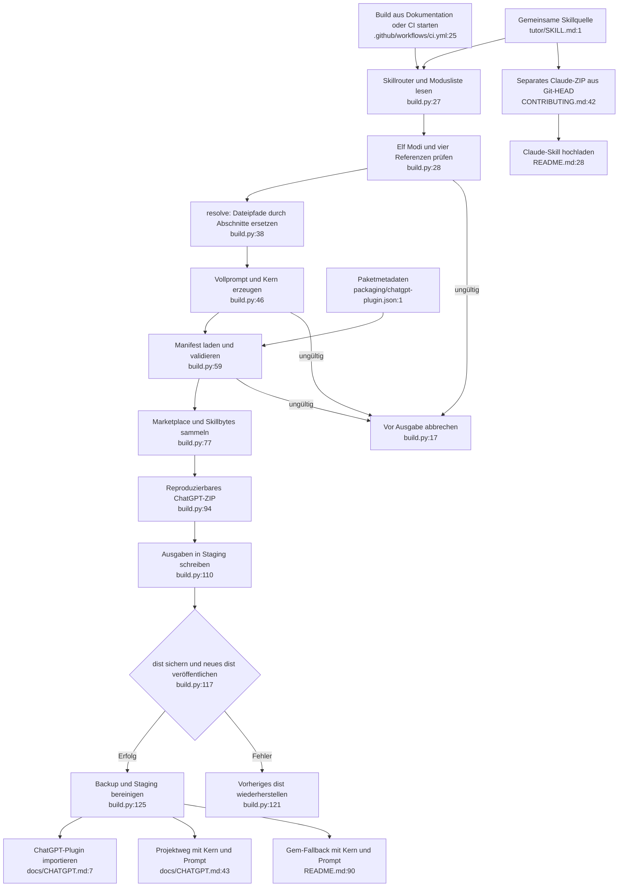

# Plattformpakete: Istfluss

Quellen: `build.py:1–138`, `packaging/chatgpt-plugin.json:1–8`, `CONTRIBUTING.md:1–60`, `.gitattributes:1–6`, `README.md:1–138`, `docs/CHATGPT.md:1–72`. Alle Pfade relativ zum Repository. HEAD 75a2cf1.

`check()` beendet fehlerhafte Builds auch unter `-O` (`build.py:17–20`). `resolve()` ist die einzige Referenztransformation (`:38–43`); Modulcode wird nicht ausgeführt. Manifest/Bytekopie/ZIP: `:59–103`. Der Builder nutzt den Arbeitsbaum, das Claude-Archiv Git-HEAD: unterschiedliche Stände sind möglich (`:91–92`, `CONTRIBUTING.md:42`). Keine native Gemini-Ausgabe vorhanden (`README.md:20,90`, `build.py:84–103`).

Effekte: lokale Dateilektüre, `.build-*` und vollständiger Austausch von `dist/`. Eigene Dateien unter `dist/` werden ersetzt; Backup und Rollback erhalten (`build.py:105–134`). Kein Netzwerk oder API-Schlüssel im Build. Der optionale Marketplace-Registrierungsbefehl ändert dagegen Benutzerkonfiguration (`docs/CHATGPT.md:22–27`); er ist kein Buildschritt.

Abhängigkeiten: Pythonstandardbibliothek, Skillquelle, Manifest und Lizenz; Git nur beim getrennten Archiv-/Releaseweg. Konten, Importer und Werkzeuge bleiben externe Voraussetzungen. Native Wrapper sind notwendige Spezialisierung, keine unterschiedlichen Tutorregeln. Hohe Sicherheit über Dateifluss; Importe ungeprüft.
