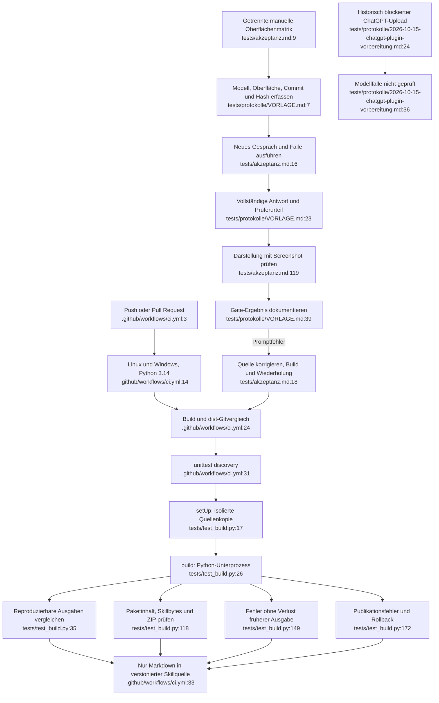

# Strukturprüfung und Oberflächenabnahme: Istfluss

Quellen: `tests/test_build.py:1–211`, `tests/akzeptanz.md:1–126`, `tests/protokolle/VORLAGE.md:1–39`, `tests/protokolle/2026-10-15-chatgpt-plugin-vorbereitung.md:1–89`, `.github/workflows/ci.yml:1–37`, `README.md:1–138`. Quellenbasis 75a2cf1, abschließend gegen 431347f geprüft; nur das historische CLI-Protokoll kam hinzu.

`BuildTests.setUp()`, `build()` und `read()` nutzen temporäre Verzeichnisse, Dateikopien und Unterprozesse, keine Modell-API (`test_build.py:17–33`). Die CI liest das manuelle Gate nicht. Unabhängige Erwartungen in Tests sind keine zu entfernende Duplikation.

Aktuelle lokale Basisprüfung am 15.10.2026: **13 Strukturtests bestanden**, gebündeltes Python unter Windows. Das ist kein Nachweis für Linux-CI oder eine Zieloberfläche.

Lücken: Gemini fehlt in Matrix und Protokollauswahl (`akzeptanz.md:9–14`, `VORLAGE.md:7`). Claude ist allein verpflichtend, ChatGPT nur Teilprüfung; ein gemeinsames Kompatibilitätsversprechen ist damit nicht abgedeckt. Der während der Analyse hinzugekommene CLI-Bericht ist vorhanden: `tests/protokolle/2026-10-15-claude-code-cli.md:1–12,28–89`. Er dokumentiert 16 Fälle an einer Ersatzoberfläche, davon drei nicht bestanden, auf einem historischen Commit; weder native Skillinstallation noch gemeinsames Drei-Plattform-Gate. Die damalige Gesamtzahl 62 ist ein historischer Stand; die heutige Matrix enthält 63 Kernfälle. Historische Ergebnisse unverändert erhalten.

Der vorhandene ChatGPT-Bericht dokumentiert keinen Modellaufruf und 28 offene Fälle (`2026-10-15-chatgpt-plugin-vorbereitung.md:3,14,32–63`). Die historische Uploadursache wurde nicht live geprüft. Fehlende Zieloberfläche bleibt nicht geprüft, kein Pass.

Abhängigkeiten: gemeinsamer Build, installierte Pakete, verfügbare Konten und Prüfer; Renderer und RTL nur sichtbar prüfbar. Hohe Sicherheit über Tests und Dateibestand; keine Aussage über reale Tutor-Kompatibilität.
