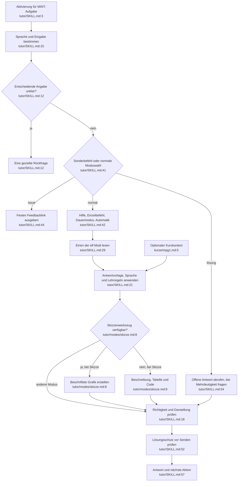

# Tutor-Dialog: Istfluss

Quelle: `tutor/SKILL.md:1–58`, alle elf `tutor/modes/*.md`, `references/sprache.md:1–26`, `didaktik.md:1–41`, `antwortvorlage.md:1–51`, `latex-regeln.md:1–37` und `kurse/mpg1.md:1–40`, jeweils unter der Skillquelle `tutor/`. Statische Discovery, HEAD 75a2cf1.

Das Diagramm beschreibt Modellanweisungen, keinen ausgeführten Parser. Sonderbefehle sind eigene Zweige; ihre Priorität gegenüber gleichzeitig vorkommenden anderen Befehlen ist teilweise unklar.

## Zustand, Fallback und Effekte

Sprache und Dauermodus werden im Gespräch geführt (`SKILL.md:41–47`, `references/sprache.md:14–16`); kein eigener Speicher. Tipp-Wiederholungen stehen in `modes/tipp.md:32–40`. Check ohne Versuch fordert diesen an (`modes/check.md:14`). Keine direkte Netzwerk-/Dateioperation durch Markdown; das Modell kann bereitgestellte Rechen- und Zeichenwerkzeuge nutzen. `!issue` sendet keine Nachricht.

## Relevante Widersprüche

- Nummernreihenfolge global gegenüber expliziten Moduslisten: `references/antwortvorlage.md:3` versus `modes/kurz.md:6`, `modes/lang.md:6`, `modes/voll.md:8–16`.
- Sperrabschnitt am Ende gegenüber Erklär-Fußteil: `references/antwortvorlage.md:35` versus `modes/erklaer.md:14–15`.
- Verständnisfrage direkt vor nächstem Schritt gegenüber Thema-Reihenfolge: `references/didaktik.md:30`, `references/antwortvorlage.md:34` versus `modes/thema.md:6`.
- `[ar] tipp` ist ein erwarteter Fall (`tests/akzeptanz.md:70`), aber Sprachpräfix vor dem Anfangsbefehl bleibt im Router unpräzise (`tutor/SKILL.md:15,25`). Das ist eine Auslegungsgefahr, kein beobachteter Modellfehler.

Abhängigkeiten: Build liest Modustabelle und Kernmarkierungen; Plattformen stellen Werkzeuge/Renderer; Akzeptanzfälle müssen Verhalten beobachten. Hohe Sicherheit über Quellen, keine Sicherheit über tatsächliche Modellausführung.
