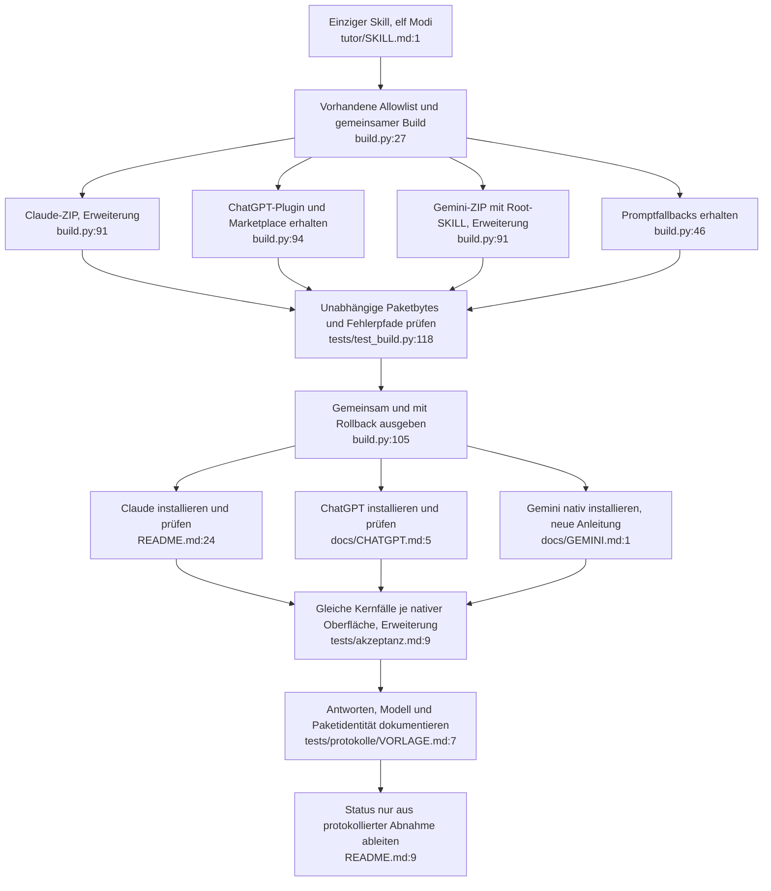

# Ziel: ein Tutor-Skill, elf Modi, drei native Plattformwege

**Entscheidung:** `tutor/` bleibt die einzige gepflegte Verhaltensquelle. Alle elf Modi bleiben in einem Skill: erklär, voll, thema, tipp, check, skizze, kurz, mittel, lang, klausur, hilfe. Unterschiedliche Importpakete enthalten dieselben Skillbytes. Kein eigenständiger Agentendienst, kein API-Schlüssel, keine neue App.

Dies ist der Architekturvorschlag, keine implementierte Kompatibilitätszusage. Der aufgerufene [Pathfinder-Skill](C:/Users/salha/.agents/skills/pathfinder/SKILL.md) verlangt "You do not write implementation code." Iststand und Discovery: [00-features.md](00-features.md), [02-duplication-report.md](02-duplication-report.md).

## 1. Gemeinsames Tutorverhalten

Komponente: vorhandener Tutor-Skill. Einziger Einstieg: `tutor/SKILL.md:1`. Referenzen liefern gemeinsame Definitionen, Modi die jeweilige Lehrform. Es gibt keine plattformspezifischen Modusdateien.

| Befund | Alter Ort | Ziel / neuer Aufruf |
|---|---|---|
| D1 | `references/antwortvorlage.md:3` konkurriert mit `modes/kurz.md:6`, `lang.md:6`, `voll.md:8–16` (jeweils unter `tutor/`) | Antwortvorlage bleibt Abschnittskatalog; die explizite Modusliste bestimmt deren Reihenfolge. Globale numerische Sortierung entfernen. Die Nummern bleiben stabile Abschnittskennungen. |
| D2 | `tutor/references/antwortvorlage.md:34–35`, `didaktik.md:30–31` gegenüber `tutor/modes/erklaer.md:14–15`, `thema.md:6` | Gemeinsamer Abschluss dort, wo vorgesehen: Fachbegriffe, Verständnisfrage, nächste Aktion, zuletzt nur der Lösungsabrufsatz. Die betroffenen Moduslisten ausrichten, ohne sichtbare Lösungen in geschützten Modi einzuführen. |
| Sprach-/Befehlsmehrdeutigkeit | `tutor/SKILL.md:15,25,42`, `tutor/modes/hilfe.md:6,34` | Sprachsignal zuerst, dann Anfangsbefehl nach erlaubtem Sprachpräfix; Hilfemodus erhält den danach aktuellen Zustand. "Letzter Befehl" eindeutig auf die normale Moduswahl beziehen, Hilfe-Ausnahme ausdrücklich benennen. Sonderkombinationen nur soweit für die bestehende Priorität nötig definieren. Kein eigener Parser. |
| Aktionsausnahmen | `tutor/SKILL.md:57`, `tutor/references/didaktik.md:31`, `modes/kurz.md:6–11`, `modes/hilfe.md:30` | Die globale Aktionsregel ausdrücklich auf die Lernmodi mit Abschluss beziehen; Kurz behält seine knappe bestehende Ausgabe, Hilfe ihre Bedienkarte, `!issue` seinen festen Link. Nicht nachträglich jeden Sonderpfad mit einer neuen Zeitangabe aufblasen. |
| Historische P1/P2 | `tests/protokolle/2026-10-15-claude-code-cli.md:51–71`, `tutor/modes/mittel.md:9`, `tutor/modes/lang.md:3,10–11` | Mittel/Lang erzeugen keine neue Übungsaufgabe im Abschluss. Lang prüft, ob eine brauchbare Alternative existiert, und erzwingt keine Umwege mit nicht gegebenen Größen. Hinweise und begrenzte Wiederholungen aus dem Protokoll übernehmen; anschließend wegen zentraler Korrekturen zusätzlich die vollständige Matrix wiederholen. |

Erhalt: sechs Sprachen, deutsche Überschriften und Klausur-Lösung, Foto-/PDF-Eingabe, Dauermodus, Abrufschutz, Skizzenfallback, optionaler Kurskontext. Lösungsschutz-Konkretisierungen pro Modus bleiben; kein Zusammenfalten aller Modi zu einem langen Universaltext. Kein Funktionsverlust beabsichtigt. Kurz-/Hilfe-Ausnahmen präzisieren bestehende knappe Formen, nicht den Auftrag erweitern.

## 2. Ein Build, dieselben Quellen, passende Pakete

Komponente: bestehendes `build.py`. Einziger Einstieg: `python build.py`. Die vorhandene Liste `[SKILL / "SKILL.md"] + files` (`build.py:91`) wird für alle nativen Pakete wiederverwendet. Keine zweite Dateisuche, keine rekursive Workspacekopie, kein Paketregister, keine Factory.

| Zieloberfläche | Geplante Ausgabe | Inhalt / Stand |
|---|---|---|
| Claude | `dist/tutor-skill.zip` | `tutor/SKILL.md`, `tutor/modes/`, `tutor/references/`; vorhandenes Claude-Layout, künftig vom gemeinsamen Builder erzeugt |
| ChatGPT | bestehendes `dist/tutor-chatgpt.zip`, zusätzlich bestehender Marketplace `dist/chatgpt/` | Manifest, MIT-Lizenz und Skill unter `skills/tutor/`; bereits implementiert, erhalten |
| Gemini | `dist/tutor-gemini.zip` | `SKILL.md` an der Archivwurzel, darunter `modes/` und `references/`; gleiche 16 Quelldateien mit anderen Präfixen. Neues Paket, bis zum tatsächlichen Import ungeprüft |
| Zusätzliche Promptwege | bestehende `dist/kern.md`, `dist/system-prompt.md` | ChatGPT Projekt und bisheriger Gem-Weg erhalten; getrennt von nativen Skillprüfungen kennzeichnen |

Die unterschiedlichen Wurzeln folgen den dokumentierten Importwegen: [Claude ZIP](https://support.claude.com/en/articles/12512180-use-skills-in-claude), [ChatGPT Skill-Verteilung](https://learn.chatgpt.com/docs/build-skills), [OpenAI-Pluginstruktur](https://developers.openai.com/plugins/build/plugins), [Gemini Skill-Import](https://support.google.com/gemini/answer/17094296?hl=en). Ein gemeinsamer Skill bedeutet keine Zusage, dass ein unverändertes ZIP in allen Importern funktioniert. Die vorgeschlagene Gemini-Wurzel ist vor Veröffentlichung am Importer zu prüfen. Rollout und Konto bleiben Voraussetzungen, keine vom Build herstellbare Funktion.

D3 wird durch einen einzigen Erzeugungsweg behoben: Der Builder liest einen Stand; Releasepakete entstehen aus demselben sauberen, genau benannten Checkout. Der separat dokumentierte `git archive ... HEAD:tutor`-Schritt entfällt zugunsten des Builderpakets. Zeitstempel/Dateiattribute für die beiden neuen ZIPs wie beim vorhandenen reproduzierbaren ZIP festsetzen. Keine lokale Git-Konfiguration ändern.

Betroffene Stellen und Aufrufer:

- `build.py:84–103`: zwei neue Archive aus derselben Allowlist/Bytequelle hinzufügen. Vorhandene ChatGPT-Ausgabe erhalten. Alle Ausgaben weiterhin vor `:105–134` validieren und gemeinsam veröffentlichen; Backup, Rollback und verständliche Fehler behalten.
- `tests/test_build.py:17–24,35–45,118–165,172–194`: bestehende Suite und temporäre Fixtures erweitern. Quellen/Manifest/Lizenz bleiben dieselben. Exakte Paketmengen und Bytes je Präfix unabhängig erwarten; CRC, Wiederholbarkeit, Ausschluss privater Dateien, entfernte Dateien und Fehler ohne Ausgabeverlust für alle Ausgaben prüfen.
- `.github/workflows/ci.yml:24–37`: derselbe Build und dieselbe Suite; der bestehende vollständige `dist/`-Vergleich erfasst neue Pakete bereits. Keine zweite Pipeline. `.gitattributes:2–4` deckt Skill-LF und alle `dist/*.zip` binär bereits ab; nur ändern, wenn neue Pfade das tatsächlich verlangen.
- `README.md:38–44`, `CONTRIBUTING.md:39–48`: alle Pakete über den gleichen Build und Checkout erzeugen; Prüfsummenliste um Gemini erweitern. Bestehender externer Downloadname `tutor-skill.zip` kann als Releaseanhang erhalten bleiben. Alte veröffentlichte Tags nicht umbelegen.
- `README.md:15–22,83–92`, `docs/CHATGPT.md:5–50`: native und Promptwege deutlich trennen; vorhandene GPT-Anleitung gezielt anpassen. Neue `docs/GEMINI.md:1` mit nativem Import und getrenntem Gem-Fallback. Keine Zusage gleicher Werkzeugausstattung oder automatischer Kontofreigabe.

D4/D5/D6 erreichen auch `GLOSSARY.md:3,13–26,33–34`, `docs/KONZEPT.md:7,16,87–101`, `CLAUDE.md:3,6–11,21–40`, `CHANGELOG.md` und `docs/index.html:377–397,459`. Produktbegriff "Tutor-Skill" vereinheitlichen; kurze Statushinweise auf die Akzeptanzmatrix verlinken. Dokumentation für Entwicklungsagenten unter `docs/agents/` ist kein Produktlaufzeitcode und wird nicht gelöscht.

Kein Fähigkeitsverlust: ChatGPT-Plugin/Marketplace und Promptfallbacks bleiben, Kurspakete bleiben außerhalb der nativen Pakete. Keine neuen Modelladapter, Dienste, SDKs, Netzwerkwerkzeuge, kostenpflichtigen Konten oder globalen Installationen für den Build.

## 3. Gemeinsame Prüfanforderung, getrennte Plattformbelege

Komponente: bestehende Strukturtests und Akzeptanzmatrix. Einstieg: `python -B -m unittest discover -s tests -v`, danach tatsächlicher nativer Oberflächenlauf.

Der neue Anforderungsumfang ersetzt das bisher alleinige Claude-Gate durch eine ausdrücklich geplante gemeinsame Freigabebedingung: **Alle drei nativen Oberflächen müssen dieselben 63 semantischen Kernfälle M01-A bis M10-C und G01 bis G33 sowie D1 bis D3 bestehen**, zuzüglich plattformspezifischer Installation/Aktivierung. Das ist eine vorgeschlagene Änderung am Releasekriterium, kein bereits bestehender oder bestandener Zustand.

- `tests/akzeptanz.md:9–18`: Claude Skill, ChatGPT Plugin und Gemini Skill als native Ziele mit gleicher Kernmenge führen. Projekt und Gem als eigene Zusatzwege erhalten. Vorhandene H01–H05 nicht umetikettieren; analoge native Import-/Aktivierungsfälle mit eindeutigen IDs ergänzen.
- `tests/akzeptanz.md:58`: Kräftediagramm und Graph nach CLI-K1 unterscheiden. Kein nachträglicher Pass für einen alten Lauf; Kriterium präzisieren und mit demselben Build wiederholen.
- `tests/protokolle/VORLAGE.md:7–14`: Plattform, Importweg, exaktes Modell, Paket-/Quellstand, SHA-256 und Datum plattformneutral erfassen. Kein künstliches ChatGPT-Marketplace-Feld für Gemini erzwingen.
- Gleich prüfen: alle elf Modi einschließlich Hilfe, Sprachpersistenz, Dauermodus, Lösung auf Abruf, Schutz bei eingebetteten Befehlen, Fotos, fehlende Eingabe, Werkzeug-/Skizzenfallback und Formeln/RTL. Es wird keine bytegleiche Antwortprosa verlangt, sondern dieselbe Lernsemantik und dieselben Schutzregeln.
- Je Ziel mit exakt geprüftem Archiv installieren; vollständige Eingabe/Antwort und sichtbares Ergebnis protokollieren. Bei fehlender Oberfläche oder Rollout: nicht geprüft. Ein CLI-/API-Lauf bleibt Ergänzung und ersetzt keinen nativen Lauf.
- Historischen CLI-Bericht mit 16 Fällen und drei Fehlern erhalten (`tests/protokolle/2026-10-15-claude-code-cli.md:3,28–45`). Bestehender ChatGPT-Bericht enthält weiterhin offene native Fälle (`2026-10-15-chatgpt-plugin-vorbereitung.md:32–63`).

Lokale Basis: 13 Strukturtests bestanden am 15.10.2026 unter Windows. Nicht neu ausgeführt: native Oberflächen, Linux-CI oder tatsächliche Releasefreigabe. Zentrale Tutoränderung verlangt nach bestehender Regel (`tests/akzeptanz.md:18`) vollständige Wiederholung; ein kleiner Smoke-Test schließt diese nicht ab.

## Zusammengeführter Zielablauf

Neue Dateipfade mit :1 sind geplante Einstiege, keine vorhandene Implementierungszeile. ZIP-Nodes verweisen auf den geplanten Erzeugungsbereich des vorhandenen Builders.

Bewusst ausgelassen: neuer Agentenbau, elf Einzelskills, abstrakte Plattformadapter, neue Abhängigkeiten, neue Testsuite, automatische Veröffentlichung oder Änderungen an Benutzerkonten. Weiterarbeit: [04-handoff-prompts.md](04-handoff-prompts.md).
