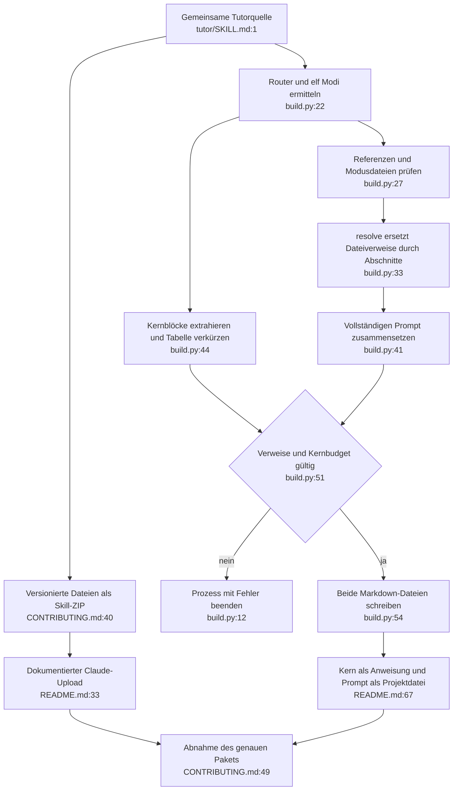

# Plattformausgabe und Bereitstellung: Ist-Zustand

Es gibt zwei Formen derselben Quelle: modularer Skill und zusammengeführter System-Prompt mit Kern. Ein nativer ChatGPT-Pluginpfad fehlt im untersuchten Build.

## Aufrufstellen und Fehlerpfade

- `check(ok, message)` (`build.py:12–15`) wird an `:24`, `:29`, `:42`, `:45`, `:51`, `:52` aufgerufen. Es prüft Moduszahl, Quelldateien, offene Verweise, Kernblöcke und internes Budget. Fehler enden mit `sys.exit`, auch unter `python -O`.
- `resolve(text)` (`build.py:33–38`) hat genau einen Aufrufer (`:41`). Es verändert nur den zusammengeführten Prompt, nicht den modularen Skill.
- `build.py:22–30` liest Router, vier Referenzen und elf Modi. `:44–50` extrahiert Kernblöcke. `:54–58` erzeugt `dist/`, schreibt zwei Dateien und meldet Zeichenzahlen. Kein Netzwerk oder Modellaufruf.
- Der Build wird durch Entwickler (`CONTRIBUTING.md:14–24`), CI (`.github/workflows/ci.yml:24–29`) und isolierte Testprozesse (`tests/test_build.py:14–26`) gestartet.
- Inhaltliche Validierungsfehler liegen vor den Schreibzugriffen. Dateisystemfehler sind nicht gesondert abgefangen; die zwei Schreibzugriffe sind keine gemeinsame atomare Aktualisierung (`build.py:22`, `:54–56`). Dies ist eine bestehende Grenze, kein Auftrag für einen vollständigen Buildumbau.

## Paket- und Änderungsgrenze

Der bisherige Paketbefehl nutzt `HEAD:tutor`; optionale Kurspakete und lokale Werkzeugzustände gehören nicht hinein (`CONTRIBUTING.md:28–40`). Releaseanhänge haben Prüfsummen (`:43–50`). Ein neuer ChatGPT-Pfad muss dieselben 16 Markdown-Quelldateien nutzen, seine Paketstruktur gesondert prüfen und die vorhandenen Projektdateinamen erhalten.

Remote-main hat inzwischen einen fertigen Download und ausführlichere Projektanweisungen: [README:84–89](https://github.com/Sae-l/tutor/blob/60b97a3ad6a5492887f1194d312908a9d7561129/README.md#L84). Die dortige Landingpage wiederholt diesen Weg in [docs/index.html:394–397](https://github.com/Sae-l/tutor/blob/60b97a3ad6a5492887f1194d312908a9d7561129/docs/index.html#L394). Bei späterer Umsetzung beide Stellen berücksichtigen.

Gelesen: `build.py:1–58`, `tutor/SKILL.md:1–58`, `CONTRIBUTING.md:5–58`, lokale `README.md:13–34`, `:63–109`, `tests/test_build.py:1–102`, lokale `.github/workflows/ci.yml:1–34`, `.gitignore:1–13`, `CLAUDE.md:5–40`, `docs/KONZEPT.md:87–110`; Remote-README vollständig und Landingpage-Treffer wie verlinkt.

Abhängigkeiten: Pythonstandardbibliothek für Build, Git für vorhandenen Archivweg; Plattformkonto für Nutzung. Konfidenz hoch für Datenfluss und Aufrufer. Installation, Konto-/Workspacefreigabe und Dateinachladen in ChatGPT sind nicht durch diesen Build belegt.
