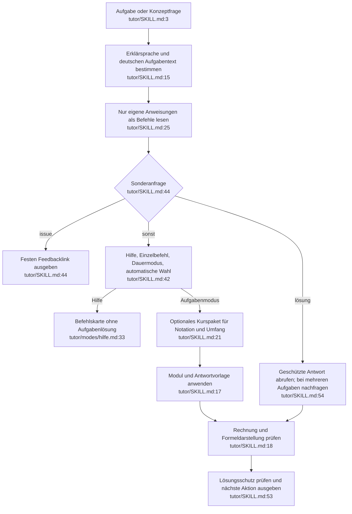

# Tutor-Dialog einschließlich Kurspaket: Ist-Zustand

Die Knoten beschreiben Modellanweisungen, keinen ausführbaren Parser. Es gibt keinen eigenen Zustandsspeicher; Sprache, Dauermodus und offene Aufgaben werden im Gespräch geführt (`tutor/SKILL.md:41–54`).

Die gegenseitige Priorität von `!issue` und weiteren Sonderbefehlen ist nicht vollständig festgelegt. Die Zeichnung macht keine zusätzliche Parserregel daraus.

## Zweige und Nebenwirkungen

- Check ohne Versuch: einmal um den Versuch bitten, nicht neu lösen (`tutor/modes/check.md:9–14`). Unleserliche entscheidende Angabe: genau eine Rückfrage (`tutor/SKILL.md:12`, `:16`).
- Tipp hält die Lösung zurück; wiederholtes Tipp führt zu engeren Fragen und schließlich Voll (`tutor/modes/tipp.md:20–40`).
- Skizze verwendet vorhandene Werkzeuge; sonst Beschreibung, Tabelle und TikZ-/matplotlib-Code (`tutor/modes/skizze.md:8–9`). Der Skill stellt diese Werkzeuge nicht selbst bereit.
- Keine eigene Datei-, Datenbank- oder Netzwerkoperation. `!issue` gibt einen Link aus und erstellt kein Issue (`tutor/SKILL.md:44`). Rechnen/Zeichnen kann Plattformwerkzeuge verwenden (`:18`).
- Kurspaket bleibt zusätzlicher Kontext außerhalb des Skillpakets (`kurse/mpg1.md:3–6`, `:30–40`).

## Wichtige Befunde

Die Sprache ist nicht vollständig einheitlich beschrieben: `tutor/SKILL.md:15` nennt Tags und `!sprache`, die Referenz akzeptiert auch natürliche Sprachsignale (`tutor/references/sprache.md:7–12`). Die zentrale Vorlage verlangt numerische Reihenfolge, Erklär/Voll haben ausdrücklich eigene Aufbauten (`tutor/references/antwortvorlage.md:3`, `tutor/modes/erklaer.md:7–15`, `tutor/modes/voll.md:7–16`). Dies sind gemeinsame Quellenfragen, keine ChatGPT-spezifischen Algorithmen.

## Quellen und Abhängigkeiten

Gelesen: `tutor/SKILL.md:1–58`; Modi `erklaer:1–21`, `voll:1–22`, `thema:1–14`, `tipp:1–40`, `check:1–14`, `skizze:1–16`, `kurz:1–12`, `mittel:1–11`, `lang:1–12`, `klausur:1–12`, `hilfe:1–35` (je `tutor/modes/<name>.md`); Referenzen `sprache:1–26`, `didaktik:1–41`, `antwortvorlage:1–51`, `latex-regeln:1–37` (je `tutor/references/<name>.md`); `kurse/mpg1.md:1–40`.

Bereitstellung muss diese Dateien oder ihre zusammengeführten Inhalte verfügbar machen. Plattformabnahme muss Aktivierung, Verhalten und Darstellung beobachten. Konfidenz hoch für Quellenaussagen, offen für tatsächliches ChatGPT-Verhalten und Zustandserhalt über Kontextgrenzen.
