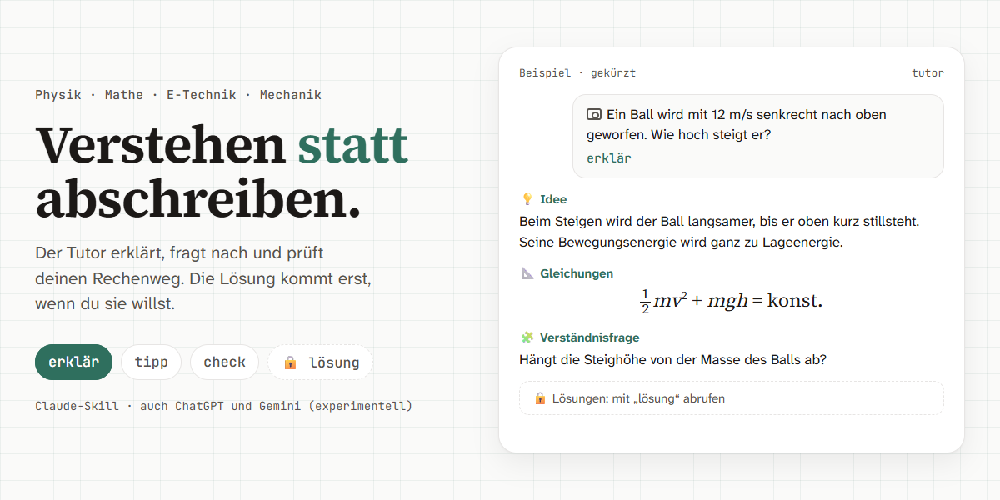
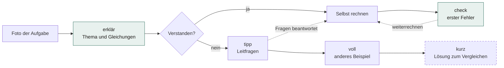

# tutor

<a href="https://sae-l.github.io/tutor/">
  <picture>
    <source media="(prefers-color-scheme: dark)" srcset="docs/assets/hero-dark.png">
    
  </picture>
</a>

**MINT-Aufgaben verstehen und selbst lösen, statt Lösungen abzuschreiben.**
Ein Lern-Tutor für Claude (und experimentell ChatGPT und Gemini) für das erste Studienjahr in Physik, Mathematik und E-Technik an deutschsprachigen Hochschulen.

[](https://github.com/Sae-l/tutor/actions/workflows/ci.yml)
[](https://github.com/Sae-l/tutor/releases)
[](LICENSE)

[Landingpage](https://sae-l.github.io/tutor/) · [So lernst du damit](#so-lernst-du-damit) · [Schnellstart](#schnellstart-claude) · [Befehle](#befehle) · [Andere Plattformen](#andere-plattformen-experimentell) · [Grenzen](#stand-und-grenzen)

> **In English:** A study tutor for first-year STEM exercises (physics, maths, electrical engineering) at German-speaking universities, packaged as a Claude Skill plus a generated system prompt for other chatbots. It explains and asks guiding questions before revealing solutions. Answers are in German by default; Arabic, Turkish, French, English or Urdu on request. The docs are in German because the target audience studies in German.

## Was der Tutor macht

- **Erst verstehen:** erklärt Thema und nötige Gleichungen, stellt Leitfragen und findet den ersten Fehler im eigenen Rechenweg.
- **Lösung erst auf Abruf:** Die Lösung kommt erst, wenn du `lösung` schreibst. Für die Klausurvorbereitung gibt es `kurz` und `klausur`.
- **Foto genügt:** Aufgabe fotografieren, optional ein Befehlswort dazu, fertig.
- **Sprachen:** Deutsch; Erklärungen auf Wunsch auf Arabisch, Türkisch, Französisch, Englisch oder Urdu. Fachbegriffe und Klausur-Lösung bleiben deutsch.
- **Feste Struktur:** kurze Schritte, immer gleiche Abschnitte. ADHS-freundlich gestaltet; das ist ein Designziel, keine nachgewiesene Wirkung.

Kein Programm und kein Dienst: Der Tutor ist eine Anweisung, die im Chatbot deiner Wahl läuft. Er speichert nichts selbst.

## So lernst du damit



Die Lösung kommt nie von selbst: Erst `lösung`, `kurz`, `mittel`, `lang` oder `klausur` geben sie heraus.

## So sieht das aus

Eingabe: `tipp` + *„Ein Wagen mit 2,0 kg beschleunigt aus Ruhe mit 3,0 m/s². Wie groß ist die resultierende Kraft?“*

<details>
<summary><b>Antwort des Tutors</b> (wörtlich aus dem <a href="tests/protokolle/2026-10-15-claude-code-cli.md">Testprotokoll</a>, Fall M04-A)</summary>

> 📋 **Gegeben / Gesucht**
>
> | Symbol | Bedeutung | Wert | Einheit |
> |---|---|---|---|
> | m | Masse des Wagens | 2,0 | kg |
> | a | Beschleunigung | 3,0 | m/s² |
> | v0 | Anfangsgeschwindigkeit („aus Ruhe“) | 0 | m/s |
> | F_res | resultierende Kraft auf den Wagen | ? | N |
>
> ❓ **Leitfragen**
>
> 1. Ist mit „resultierende Kraft“ eine einzelne Kraft gemeint oder die Summe aller Kräfte, die auf den Wagen wirken?
> 2. Brauchst du die Angabe „aus Ruhe“ für die gesuchte Kraft, oder bräuchtest du sie nur für eine Geschwindigkeit oder eine Strecke?
> 3. Welches Grundgesetz der Mechanik verbindet die resultierende Kraft mit Masse und Beschleunigung?
> 4. Sind m und a schon in SI-Einheiten angegeben, sodass du ohne Umrechnung einsetzen kannst?
> 5. Aus welchen Basiseinheiten setzt sich das Newton zusammen, und ergibt dein Produkt der Einheiten genau das?
> 6. Wie viele signifikante Stellen haben die Angaben, und mit wie vielen gibst du deshalb das Ergebnis an?
>
> ➡️ **Nächster Schritt**
> Beantworte die Fragen der Reihe nach auf Papier und rechne dann das Ergebnis aus. Dafür hast du höchstens 5 Minuten. Wenn du nicht weiterkommst, hast du drei Möglichkeiten:
> - Schicke mir deine Antwort auf die Frage, an der du hängst.
> - Schreibe noch einmal „tipp“, dann bekommst du engere Fragen.
> - Schreibe „voll“, dann bekommst du ein vorgerechnetes Beispiel.
>
> 🔒 **Lösungen**
> Mit ‚lösung‘ abrufen.

</details>

Danach den eigenen Rechenweg schicken → der Tutor sucht den ersten Fehler (`check`). Zum Vergleichen: `kurz`.

## Schnellstart (Claude)

Du brauchst ein Claude-Konto. Skills gibt es laut [Claude-Hilfe](https://support.claude.com/en/articles/12512180-use-skills-in-claude) in allen Tarifen (Free, Pro, Max, Team, Enterprise); sie setzen eingeschaltete Code-Ausführung voraus. Die Menünamen stammen aus der englischen Oberfläche; in der deutschen können sie anders heißen.

1. `tutor-skill.zip` aus dem [neuesten Release](https://github.com/Sae-l/tutor/releases) herunterladen. **Nicht entpacken.**
2. Auf [claude.ai](https://claude.ai) unter *Settings → Capabilities* „Code execution and file creation“ einschalten. Bei Team und Enterprise schaltet das die Administration unter *Organization settings → Plugins & skills* frei.
3. Unter *Customize → Skills* auf „+“ → „Create skill“ → „Upload a skill“ klicken und die ZIP hochladen. Der Skill „tutor“ muss eingeschaltet sein.
4. **Testen:** In einem neuen Chat nur `tutor` schreiben. Erscheint die Befehlskarte, ist der Tutor aktiv.
5. **Lernen:** Foto der Aufgabe schicken, optional mit einem Befehlswort.

**Aktualisieren:** Neue ZIP herunterladen. Dann unter *Customize → Skills* den Skill „tutor“ öffnen, ausschalten, über „…“ → „Delete“ löschen und die neue Datei hochladen. Was sich geändert hat, steht im [CHANGELOG](CHANGELOG.md).

<details>
<summary>Fehlerbehebung</summary>

| Problem | Lösung |
|---|---|
| Hochladen schlägt fehl | ZIP unverändert hochladen. Neu gepackte Archive haben oft nicht den Ordner `tutor/` an oberster Stelle; dann erkennt Claude den Skill nicht. |
| `tutor` zeigt keine Befehlskarte | Code-Ausführung und Skill „tutor“ eingeschaltet? Neuen Chat öffnen. Sonst Skill löschen und neu hochladen. |
| Formeln erscheinen als `$$…$$` | Die Plattform rendert kein LaTeX. In Claude im Browser normalerweise kein Problem; ChatGPT und Gemini sind nicht geprüft. |
| Antwort verrät die Lösung zu früh | Fehler im Lösungsschutz: bitte als [Issue](https://github.com/Sae-l/tutor/issues/new) melden, ohne Aufgabentext oder persönliche Daten. |
| Handy-App | Den Skill einmal im Browser hochladen. Ob er in der Claude-App genauso greift, ist nicht geprüft. |

</details>

<details>
<summary>Als Plugin in Claude Code oder Codex</summary>

Das Repository ist zugleich ein Marketplace für Claude Code und Codex; beide installieren dasselbe erzeugte Plugin aus `dist/chatgpt/plugins/tutor/`. In Claude Code:

```text
/plugin marketplace add Sae-l/tutor
/plugin install tutor@tutor
```

Ab Claude Code 2.1.275 geht es in einem Schritt: `/plugin install tutor --marketplace Sae-l/tutor`. Aktualisieren mit `/plugin marketplace update tutor`. Der Skill heißt dann `tutor:tutor`; in Claude Code ist er nicht nach dem Release-Gate abgenommen. Im Terminal erscheinen Formeln zunächst als Rohcode; ein kurzer Hinweis darauf schaltet auf Klartextformeln um.

In der Codex CLI bzw. ChatGPT Desktop (experimentell):

```text
codex plugin marketplace add Sae-l/tutor
```

Danach die Quelle **Tutor** im Pluginverzeichnis öffnen und **tutor** installieren; weitere Schritte in [docs/CHATGPT.md](docs/CHATGPT.md).

</details>

<details>
<summary>Selbst bauen (ungeprüfter Stand von <code>main</code>)</summary>

```bash
git clone https://github.com/Sae-l/tutor.git
cd tutor
git archive --format=zip -o tutor-skill.zip HEAD tutor/
```

</details>

## Befehle

Ein Befehlswort steht am Anfang der Nachricht (z. B. Foto + „tipp“). Mit `!` davor wirkt es auch mitten in der Nachricht. `hilfe` zeigt die Befehlskarte. Empfohlene Reihenfolge: **erklär → tipp → voll → kurz**.

| Befehl | Wirkung |
|---|---|
| (keiner) / `erklär` | Thema und nötige Gleichungen, **ohne** Beispiel und **ohne** Lösung |
| `voll` | anschaulich und mathematisch, mit vorgerechnetem Beispiel einer anderen Aufgabe |
| `thema` | Begriff oder Gesetz verstehen und wie es beim Lösen hilft |
| `tipp` | Leitfragen, die man sich selbst stellt; Lösung zurückgehalten |
| `check` | Fehlerdiagnose des eigenen Versuchs (automatisch, wenn ein Versuch mitkommt) |
| `skizze` | Skizze, Diagramm oder Graph (mit Zeichenwerkzeug als Bild, sonst Beschreibung + TikZ/matplotlib) |
| `kurz` | Klausur-Lösung auf Deutsch plus eine Anmerkung |
| `mittel` | Erklärung mittlerer Tiefe mit vollständiger Lösung |
| `lang` | vollständige Lösung plus bis zu zwei andere Lösungswege |
| `klausur` | schnelle Lösung mit Tipps für volle Punktzahl |
| `hilfe` | Befehlskarte |
| `!issue` | Link für Feedback |

- **Lösungsschutz:** Erklär, Thema, Tipp und Voll halten die Originalrechnung, vollständige Beweise und Auswahlantworten zurück, auch in Bildern und Code. Skizzen zeigen Gegebenes; ein persönlich verlangter Graph erlaubt seine nötigen Berechnungen. Check korrigiert nur die erste fehlerhafte Stelle. `lösung` ruft den eindeutig gemeinten Inhalt ab; bei mehreren offenen Aufgaben oder Fragen wird einmal nachgefragt. Kurz, Mittel, Lang und Klausur erlauben die Lösung. 🔒 allein versteckt keinen Text. Native Prüfung dieser Regeln bleibt offen.
- **Dauermodus:** `!an tipp` (oder ein anderer Befehl) gilt für alle folgenden Aufgaben, bis `!aus` kommt.
- **Sprache:** `[ar]` Arabisch, `[tr]` Türkisch, `[fr]` Französisch, `[en]` Englisch, `[ur]` Urdu, `[de]` zurück, oder `!sprache ar` usw. Ohne Wunsch antwortet der Tutor auf Deutsch, auch wenn du anders schreibst. Überschriften, Aufgabentext und Klausur-Lösung bleiben deutsch, damit das Prüfungsvokabular mitgelernt wird.
- **Kurspaket (optional):** eine Markdown-Datei mit Notation und Stoffumfang eines Kurses, z. B. [kurse/mpg1.md](kurse/mpg1.md). In Claude ein Projekt anlegen und die Datei dort als Projektwissen hochladen. Sie gehört nicht zum Skill; bei Bezeichnungen und Stoffumfang hat sie Vorrang.

## Andere Plattformen (experimentell)

| Plattform | Dateien | Stand |
|---|---|---|
| **Claude Skill** (empfohlen) | `tutor-skill.zip` | primär; Release-Gate mit allen Akzeptanzfällen |
| [ChatGPT Plugin](docs/CHATGPT.md#native-variante-plugin-archiv) | `tutor-chatgpt.zip`; alternativ lokaler Marketplace `dist/chatgpt/` | experimentell; noch nicht auf ChatGPT abgenommen |
| ChatGPT Projekt | `kern.md` als Anweisung, `system-prompt.md` als Datei | experimentell; Teilabnahme vorgesehen |
| Gemini Skill | `tutor-skill.zip` | experimentell, nicht geprüft; offen, ob Gemini das ZIP mit dem Ordner `tutor/` an oberster Stelle annimmt |
| Gemini Gem (auslaufend) | wie ChatGPT Projekt | endet für private Konten ab November 2026, für Workspace 2027; nicht geprüft |

Alle Dateien liegen im [Release](https://github.com/Sae-l/tutor/releases). ChatGPT-ZIP und Promptdateien entsprechen `dist/`; das Skill-ZIP (Claude, Gemini) enthält die versionierte Quelle `tutor/`.

- **ChatGPT:** Plugin, Projektweg und Funktionsprüfung beschreibt die [Schritt-für-Schritt-Anleitung](docs/CHATGPT.md). Vorgesehen sind Plugin und Projekt, kein neuer Custom GPT ([OpenAI zu Skills und Plugins](https://learn.chatgpt.com/docs/build-skills)).
- **ChatGPT Projekt:** neues Projekt anlegen, den Inhalt von `kern.md` in die Projektanweisungen kopieren und `system-prompt.md` als Projektdatei hinzufügen.
- **Gemini Skill:** in der [Gemini-App](https://gemini.google.com) unter *Einstellungen → Skills → Erstellen* `tutor-skill.zip` unverändert hochladen; aufrufen mit `/` oder `@`. Voraussetzungen laut [Google-Hilfe](https://support.google.com/gemini/answer/17094296): 18+, „Keep Activity“ eingeschaltet, Hochladen nur im Web oder in der Mac-App. Ungetestet; ob der Import mit dem Ordner `tutor/` an oberster Stelle klappt, ist offen.
- **Gemini Gem (auslaufend):** neuen Gem anlegen, `kern.md` in die Anweisungen kopieren und `system-prompt.md` als Wissen hochladen. Gems werden laut [Google](https://support.google.com/gemini/answer/18560919) für private Konten ab November 2026 und für Workspace 2027 in Skills umgewandelt.

`kern.md` hat höchstens 4000 Zeichen (internes Buildbudget, keine offizielle Plattformgrenze). Menünamen können abweichen; Formeldarstellung, RTL und Aufklappblöcke sind dort nicht abgenommen.

## Stand und Grenzen

- **Version v0.2.0, Lehrverhalten nicht abgenommen.** Build und Strukturtests laufen. Ein begrenzter [Claude-CLI-Ersatzlauf](tests/protokolle/2026-10-15-claude-code-cli.md) prüfte 16 Fälle; drei bestanden nicht. Echte Zieloberflächen einschließlich ChatGPT sind noch nicht abgenommen ([Akzeptanzmatrix](tests/akzeptanz.md)).
- Formeln werden nur sauber dargestellt, wenn die Plattform `$$ ... $$` rendert; das ist nur informell beobachtet, nicht protokolliert.
- Hochgeladene Dateien liest das Modell nicht immer vollständig; deshalb stehen die wichtigsten Regeln im Kern.
- Der Tutor kennt keine Bewertungskriterien einzelner Hochschulen. Ergebnisse mit offiziellen Musterlösungen abgleichen.
- Die Lernprinzipien in [docs/KONZEPT.md](docs/KONZEPT.md) begründen das Design, belegen aber keine Wirksamkeit dieses Tutors, auch nicht für ADHS.

## Datenschutz und Feedback

Der Tutor speichert nichts selbst; Gespräche liegen beim jeweiligen Anbieter (Anthropic, OpenAI, Google) nach dessen Bedingungen. `!issue` erzeugt nur einen Link mit festem Titel und schickt keine Gesprächsinhalte.

Feedback: [Issue anlegen](https://github.com/Sae-l/tutor/issues/new/choose) oder im Tutor `!issue` schreiben. Issues sind öffentlich: keine Aufgabentexte, Namen oder Fotos mit persönlichen Daten einfügen. Sicherheitslücken bitte privat melden, siehe [SECURITY.md](SECURITY.md).

## Unterstützen und Kontakt

Der Tutor ist frei und quelloffen. Wenn er dir hilft, kannst du das Projekt über [PayPal unterstützen](https://www.paypal.me/saaidalhallak).

- **Über mich:** [LinkedIn](https://www.linkedin.com/in/saeed-alhalak/) · [Instagram](https://www.instagram.com/s.hlllk/) · [PayPal](https://www.paypal.me/saaidalhallak)
- **GitHub:** [Quellcode](https://github.com/Sae-l/tutor) · [Probleme, Wünsche, Verbesserungsvorschläge](https://github.com/Sae-l/tutor/issues/new/choose)
- **Website:** [sae-l.github.io/tutor](https://sae-l.github.io/tutor/)

## Mitmachen

Die [deutsche Wissensbasis](Obsidian-tutor/00%20Startseite.md) erklärt Funktionsweise, alle elf Modi, wissenschaftliche Grundlagen, Plattformgrenzen, Bau, Fehlerdiagnose, Sicherheit und Website. Für Wikilinks, Graph und die [Canvas-Landkarte](Obsidian-tutor/Tutor-Landkarte.canvas) das Repository klonen und den Unterordner `Obsidian-tutor` in Obsidian als Vault öffnen. Community-Plugins, Sync und Publish sind nicht erforderlich.

<details>
<summary>Aufbau des Repos</summary>

| Pfad | Zweck |
|---|---|
| `tutor/` | Gemeinsame Skillquelle (`SKILL.md` als Router + `modes/` + `references/`) |
| `kurse/` | optionale Kurspakete, nicht Teil des Skills |
| `dist/system-prompt.md` | Erzeugt: alles in einer Datei, für andere Plattformen |
| `dist/kern.md` | Erzeugt: Kern aus den `<!-- kern -->`-Abschnitten von `SKILL.md`, höchstens 4000 Zeichen |
| `dist/chatgpt/` | Erzeugter lokaler Marketplace mit einem Tutor-Plugin, Skilldateien und MIT-Lizenz |
| `dist/tutor-chatgpt.zip` | Erzeugtes Pluginarchiv für den ChatGPT-Importer |
| `packaging/chatgpt-plugin.json` | Paketidentität und Version des nativen Plugins |
| `build.py` | Erzeugt `dist/` aus der Quelle |
| `tests/` | Strukturtests, Akzeptanzfälle, Protokolle der Abnahme |
| `docs/KONZEPT.md` | Hintergrund: Ziel, Lernprinzipien, Architekturentscheidungen |
| `Obsidian-tutor/` | Deutsche Wissensbasis mit 20 Notizen, Canvas, Quellnachweisen und lesender Prüfung |
| `docs/planung/` | Planungsnotizen und Recherchen (Stand jeweils im Dateinamen), keine Anleitung |
| `docs/index.html` | Landingpage für GitHub Pages (eine Datei, ohne Build); Schriften lokal in `docs/fonts/` (SIL OFL) |
| `GLOSSARY.md` | Festgelegte Begriffe |

</details>

<details>
<summary>Entwicklung und Tests</summary>

Eine Quelle, alle Pakete:


Voraussetzung: Git und Python 3.14 (nur Standardbibliothek).

```bash
python build.py
```

```bash
python -B -m unittest discover -s tests -v
```

Verhalten nur in `tutor/` ändern, danach `python build.py` ausführen und die erzeugte Ausgabe mitcommitten. `dist/` wird vollständig ersetzt; dort nichts von Hand ablegen. Die Tests prüfen reproduzierbare Ausgaben, Pluginmanifest und Paketinhalt, Bytegleichheit zur Skillquelle, elf Modi, Kursneutralität, Kernbudget, Formelbeispiele und den Erhalt vorhandener Ausgaben bei ungültigen Quellen/Metadaten sowie fehlgeschlagenem Verzeichnistausch. Die CI führt denselben Build und dieselben Tests auf Linux und Windows aus.

[tests/akzeptanz.md](tests/akzeptanz.md) enthält das Release-Gate, 30 Modusfälle, 33 Zustands- und Grenzfälle und fünf native ChatGPT-Installations-/Aktivierungsfälle, je mit stabiler ID. Bestandene Strukturtests belegen kein korrektes Tutorverhalten.

</details>

Ablauf, Release-Checkliste und Paketbau: [CONTRIBUTING.md](CONTRIBUTING.md). Änderungen: [CHANGELOG.md](CHANGELOG.md). Lizenz: [MIT](LICENSE).
