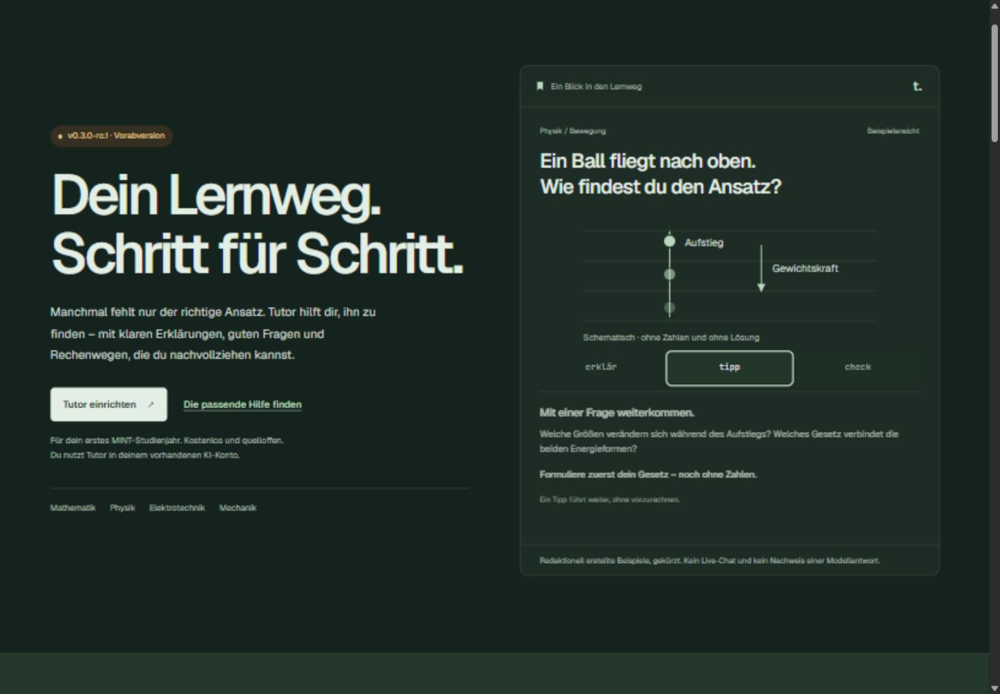
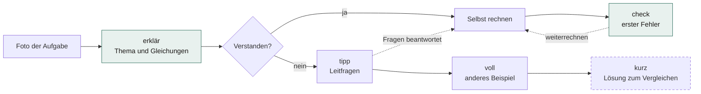
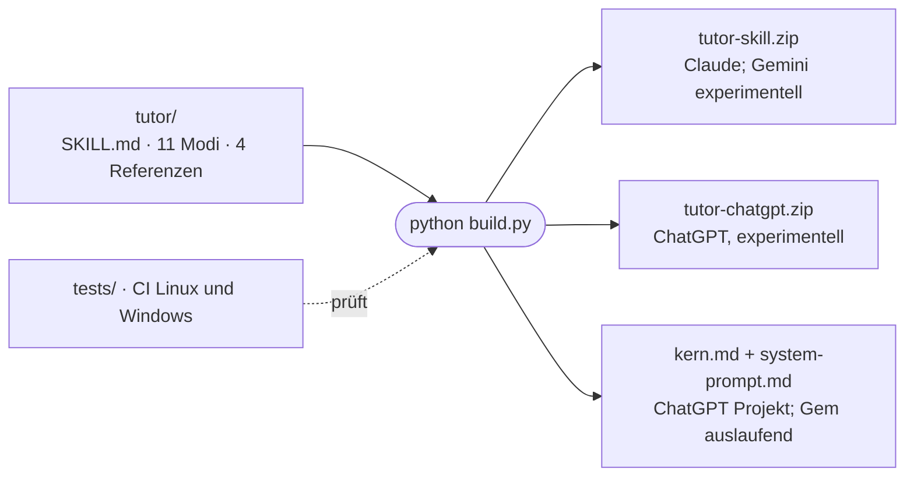

# tutor

[](https://sae-l.github.io/tutor/)

**MINT-Aufgaben verstehen und selbst lösen, statt Lösungen abzuschreiben.**
Ein Lern-Tutor für dein erstes Studienjahr in Mathematik, Physik, Elektrotechnik und Mechanik. Kostenlos und quelloffen; du nutzt dein vorhandenes KI-Konto. Tarife und Nutzungsgrenzen des Anbieters gelten zusätzlich.

**[Tutor kennenlernen und einrichten →](https://sae-l.github.io/tutor/)** · [Dokumentationsübersicht](docs/README.md)

[](https://github.com/Sae-l/tutor/actions/workflows/ci.yml)
[](https://github.com/Sae-l/tutor/releases)
[](LICENSE)

[Landingpage](https://sae-l.github.io/tutor/) · [So lernst du damit](#so-lernst-du-damit) · [Schnellstart](#schnellstart-claude) · [Befehle](#befehle) · [Andere Plattformen](#andere-plattformen-experimentell) · [Grenzen](#stand-und-grenzen)

> **In English:** A study tutor for first-year STEM exercises (physics, maths, electrical engineering) at German-speaking universities, packaged as a Claude Skill plus a generated system prompt for other chatbots. It explains and asks guiding questions before revealing solutions. Answers are in German by default; Arabic, Turkish, French, English or Urdu on request. The docs are in German because the target audience studies in German.

## Neu in v0.3.0-rc.1

Einfache Erklärungen mit passenden Vergleichen und deren Grenzen, begründete Herleitungen sowie bis zu drei sinnvolle Lösungswege. Technische Skizzen entstehen mit kontrolliertem Zeichencode statt kostenpflichtiger Bildgenerierung. Vorhandene Befehle und Lösungsschutz bleiben erhalten. Die Regeln richten sich weiterhin an das erste MINT-Studienjahr; ein Nutzen für jeden Studierenden ist ein Ziel, kein Wirksamkeitsnachweis. [Abnahmekriterien](tests/modi-v030.md) und [Releasegrenzen](docs/releases/v0.3.0-rc.1.md).

## Was der Tutor macht

- **Erst verstehen:** erklärt Thema und nötige Gleichungen, stellt Leitfragen und findet den ersten Fehler im eigenen Rechenweg.
- **Lösung erst auf Abruf:** Die Originalrechnung bleibt in den Verständnis-Modi zurückgehalten. `lösung` oder ein Lösungsmodus rufen sie ausdrücklich ab. Für die Klausurvorbereitung gibt es `kurz` und `klausur`.
- **Foto genügt:** Aufgabe fotografieren, optional ein Befehlswort dazu, fertig.
- **Sprachen:** Deutsch; Erklärungen auf Wunsch auf Arabisch, Türkisch, Französisch, Englisch oder Urdu. Fachbegriffe und Klausur-Lösung bleiben deutsch.
- **Feste Struktur:** kurze Schritte, immer gleiche Abschnitte. ADHS-freundlich gestaltet; das ist ein Designziel, keine nachgewiesene Wirkung.

Kein Programm und kein Dienst: Der Tutor ist eine Anweisung, die im Chatbot deiner Wahl läuft. Er speichert nichts selbst.

## So lernst du damit



Die Lösung kommt nie von selbst: Erst `lösung`, `kurz`, `mittel`, `lang` oder `klausur` geben sie heraus.

## Schnellstart (Claude)

1. [tutor-skill.zip herunterladen](https://github.com/Sae-l/tutor/releases/download/v0.3.0-rc.1/tutor-skill.zip). Die Datei nicht entpacken.
2. Auf [claude.ai unter Anpassungen → Skills](https://claude.ai/customize/skills) „Skill hinzufügen“ und „Skill hochladen“ wählen. ZIP hochladen und Tutor einschalten. Verfügbarkeit und Menünamen können abweichen.
3. In einem neuen Chat Tutor auswählen und **`hilfe`** schreiben. Danach eine Aufgabe mit einem Befehlswort schicken.

Import und Aktivierung wurden im Webbrowser beobachtet. Das belegt keine vollständige Verhaltensabnahme. Bei einem Update die neue ZIP hochladen und eine angebotene Ersetzung bestätigen; im beobachteten Webweg bleiben ältere Versionen im Versionsverlauf erhalten. [Änderungen](CHANGELOG.md).

<details>
<summary>Fehlerbehebung</summary>

| Problem | Lösung |
|---|---|
| Hochladen schlägt fehl | ZIP unverändert hochladen. Neu gepackte Archive haben oft nicht den Ordner `tutor/` an oberster Stelle; dann erkennt Claude den Skill nicht. |
| `hilfe` zeigt keine Befehlskarte | Skill „tutor“ eingeschaltet und im Chat ausgewählt? Neuen Chat öffnen und `hilfe` schreiben. |
| Formeln erscheinen als `$$…$$` | Die Plattform rendert kein LaTeX. In Claude im Browser normalerweise kein Problem; ChatGPT und Gemini sind nicht geprüft. |
| Antwort verrät die Lösung zu früh | Fehler im Lösungsschutz: bitte als [Issue](https://github.com/Sae-l/tutor/issues/new) melden, ohne Aufgabentext oder persönliche Daten. |
| Handy-App | Den Skill einmal im Browser hochladen. Ob er in der Claude-App genauso greift, ist nicht geprüft. |

</details>

<details>
<summary>Als Plugin in Claude Code oder Codex</summary>

Das Repository ist zugleich ein Marketplace für Claude Code und Codex; beide installieren dasselbe erzeugte Plugin aus `dist/chatgpt/plugins/tutor/`. In Claude Code:

```text
/plugin marketplace add Sae-l/tutor
/plugin install tutor@tutor
```

Ab Claude Code 2.1.275 geht es in einem Schritt: `/plugin install tutor --marketplace Sae-l/tutor`. Aktualisieren mit `/plugin marketplace update tutor`. Der Skill heißt dann `tutor:tutor`; in Claude Code ist er nicht nach dem Release-Gate abgenommen. Im Terminal erscheinen Formeln zunächst als Rohcode; ein kurzer Hinweis darauf schaltet auf Klartextformeln um.

In der Codex CLI bzw. ChatGPT Desktop (experimentell):

```text
codex plugin marketplace add Sae-l/tutor
```

Danach die Quelle **Tutor** im Pluginverzeichnis öffnen und **tutor** installieren; weitere Schritte in [docs/CHATGPT.md](docs/CHATGPT.md).

</details>

<details>
<summary>Selbst bauen (ungeprüfter Stand von <code>main</code>)</summary>

```bash
git clone https://github.com/Sae-l/tutor.git
cd tutor
git archive --format=zip -o tutor-skill.zip HEAD tutor/
```

</details>

## Befehle

Ein Befehlswort steht am Anfang der Nachricht (z. B. Foto + „tipp“). Mit `!` davor wirkt es auch mitten in der Nachricht. `hilfe` zeigt die Befehlskarte. Empfohlene Reihenfolge: **erklär → tipp → voll → kurz**.

| Befehl | Wirkung |
|---|---|
| (keiner) / `erklär` | Thema und nötige Gleichungen, **ohne** Beispiel und **ohne** Lösung |
| `voll` | anschaulich und mathematisch, mit vorgerechnetem Beispiel einer anderen Aufgabe |
| `thema` | Begriff oder Gesetz verstehen und wie es beim Lösen hilft |
| `tipp` | Leitfragen, die man sich selbst stellt; Lösung zurückgehalten |
| `check` | Fehlerdiagnose des eigenen Versuchs (automatisch, wenn ein Versuch mitkommt) |
| `skizze` | Skizze, Diagramm oder Graph (mit Zeichenwerkzeug als Bild, sonst Beschreibung + TikZ/matplotlib) |
| `kurz` | Klausur-Lösung auf Deutsch plus eine Anmerkung |
| `mittel` | Erklärung mittlerer Tiefe mit vollständiger Lösung |
| `lang` | vollständige Lösung plus bis zu zwei andere Lösungswege |
| `klausur` | kompakte Originallösung mit allgemeinen Hinweisen zur Klausurdarstellung |
| `hilfe` | Befehlskarte |
| `!issue` | Link für Feedback |

- **Lösungsschutz:** Erklär, Thema, Tipp und Voll halten die Originalrechnung, vollständige Beweise und Auswahlantworten zurück, auch in Bildern und Code. Skizzen zeigen Gegebenes; ein persönlich verlangter Graph erlaubt seine nötigen Berechnungen. Check korrigiert nur die erste fehlerhafte Stelle. `lösung` ruft den eindeutig gemeinten Inhalt ab; bei mehreren offenen Aufgaben oder Fragen wird einmal nachgefragt. Kurz, Mittel, Lang und Klausur erlauben die Lösung. 🔒 allein versteckt keinen Text. Native Prüfung dieser Regeln bleibt offen.
- **Dauermodus:** `!an tipp` (oder ein anderer Befehl) gilt für alle folgenden Aufgaben, bis `!aus` kommt.
- **Sprache:** `[ar]` Arabisch, `[tr]` Türkisch, `[fr]` Französisch, `[en]` Englisch, `[ur]` Urdu, `[de]` zurück, oder `!sprache ar` usw. Ohne Wunsch antwortet der Tutor auf Deutsch, auch wenn du anders schreibst. Überschriften, Aufgabentext und Klausur-Lösung bleiben deutsch, damit das Prüfungsvokabular mitgelernt wird.
- **Kurspaket (optional):** eine Markdown-Datei mit Notation und Stoffumfang eines Kurses, z. B. [kurse/mpg1.md](kurse/mpg1.md). In Claude ein Projekt anlegen und die Datei dort als Projektwissen hochladen. Sie gehört nicht zum Skill; bei Bezeichnungen und Stoffumfang hat sie Vorrang.

## Andere Plattformen (experimentell)

| Oberfläche | Dateien und Anleitung | Prüfstatus |
|---|---|---|
| Claude Web | `tutor-skill.zip`, siehe Schnellstart | Primärer Weg; Import beobachtet, vollständige Verhaltensabnahme offen |
| ChatGPT / Codex | `tutor-chatgpt.zip` oder Marketplace; [Anleitung](docs/CHATGPT.md) | Experimentell; keine vollständige native Abnahme |
| ChatGPT Projekt | `kern.md` als Anweisung, `system-prompt.md` als Projektdatei | Experimentell; keine vollständige native Abnahme |
| Gemini | `tutor-skill.zip`; [offizielle Hilfe](https://support.google.com/gemini/answer/17094296) | Experimentell; Annahme der ZIP-Ordnerstruktur und Verhalten unbestätigt |

Alle Dateien samt Prüfsummen stehen im [Release v0.3.0-rc.1](https://github.com/Sae-l/tutor/releases/tag/v0.3.0-rc.1). GitHub ist der Quellcodehost; native Copilot-Unterstützung ist nicht bestätigt. `kern.md` hat ein internes Buildbudget von 4000 Zeichen, keine offizielle Plattformgrenze. Menünamen, Formeldarstellung und Regeltreue sind je Oberfläche gesondert zu prüfen.

## Stand und Grenzen

- **Vorabversion v0.3.0-rc.1, Lehrverhalten nicht vollständig abgenommen.** Build und Strukturtests laufen. Ein begrenzter [Claude-CLI-Ersatzlauf](tests/protokolle/2026-10-15-claude-code-cli.md) prüfte 16 Fälle; drei bestanden nicht. Echte Zieloberflächen einschließlich ChatGPT sind noch nicht abgenommen ([Akzeptanzmatrix](tests/akzeptanz.md)).
- Formeln werden nur sauber dargestellt, wenn die Plattform `$$ ... $$` rendert; das ist nur informell beobachtet, nicht protokolliert.
- Hochgeladene Dateien liest das Modell nicht immer vollständig; deshalb stehen die wichtigsten Regeln im Kern.
- Der Tutor kennt keine Bewertungskriterien einzelner Hochschulen. Ergebnisse mit offiziellen Musterlösungen abgleichen.
- Die Lernprinzipien in [docs/KONZEPT.md](docs/KONZEPT.md) begründen das Design, belegen aber keine Wirksamkeit dieses Tutors, auch nicht für ADHS.

## Datenschutz und Feedback

Der Tutor speichert nichts selbst; Gespräche liegen beim jeweiligen Anbieter (Anthropic, OpenAI, Google) nach dessen Bedingungen. `!issue` erzeugt nur einen Link mit festem Titel und schickt keine Gesprächsinhalte.

Feedback: [Issue anlegen](https://github.com/Sae-l/tutor/issues/new/choose) oder im Tutor `!issue` schreiben. Issues sind öffentlich: keine Aufgabentexte, Namen oder Fotos mit persönlichen Daten einfügen. Sicherheitslücken bitte privat melden, siehe [SECURITY.md](SECURITY.md).

## Unterstützen und Kontakt

Der Tutor ist frei und quelloffen. Wenn er dir hilft, kannst du das Projekt über [PayPal unterstützen](https://www.paypal.me/saaidalhallak).

- **Über mich:** [LinkedIn](https://www.linkedin.com/in/saeed-alhalak/) · [Instagram](https://www.instagram.com/s.hlllk/) · [PayPal](https://www.paypal.me/saaidalhallak)
- **GitHub:** [Quellcode](https://github.com/Sae-l/tutor) · [Probleme, Wünsche, Verbesserungsvorschläge](https://github.com/Sae-l/tutor/issues/new/choose)
- **Website:** [sae-l.github.io/tutor](https://sae-l.github.io/tutor/)

## Mitmachen

Die [deutsche Wissensbasis](Obsidian-tutor/00%20Startseite.md) erklärt Funktionsweise, alle elf Modi, wissenschaftliche Grundlagen, Plattformgrenzen, Bau, Fehlerdiagnose, Sicherheit und Website. Für Wikilinks, Graph und die [Canvas-Landkarte](Obsidian-tutor/Tutor-Landkarte.canvas) das Repository klonen und den Unterordner `Obsidian-tutor` in Obsidian als Vault öffnen. Community-Plugins, Sync und Publish sind nicht erforderlich.

Die [Dokumentationsübersicht](docs/README.md) erklärt die Repositorystruktur und trennt Lernhilfe, Plattformwege, Nachweise und Entwicklung.

<details>
<summary>Entwicklung und Tests</summary>

Eine Quelle, alle Pakete:



Voraussetzung: Git und Python 3.14 (nur Standardbibliothek).

```bash
python build.py
```

```bash
python -B -m unittest discover -s tests -v
```

Verhalten nur in `tutor/` ändern, danach `python build.py` ausführen und die erzeugte Ausgabe mitcommitten. `dist/` wird vollständig ersetzt; dort nichts von Hand ablegen. Die Tests prüfen reproduzierbare Ausgaben, Pluginmanifest und Paketinhalt, Bytegleichheit zur Skillquelle, elf Modi, Kursneutralität, Kernbudget, Formelbeispiele und den Erhalt vorhandener Ausgaben bei ungültigen Quellen/Metadaten sowie fehlgeschlagenem Verzeichnistausch. Die CI führt denselben Build und dieselben Tests auf Linux und Windows aus.

[tests/akzeptanz.md](tests/akzeptanz.md) enthält das Release-Gate, 30 Modusfälle, 33 Zustands- und Grenzfälle und fünf native ChatGPT-Installations-/Aktivierungsfälle, je mit stabiler ID. Bestandene Strukturtests belegen kein korrektes Tutorverhalten.

</details>

Ablauf, Release-Checkliste und Paketbau: [CONTRIBUTING.md](CONTRIBUTING.md). Änderungen: [CHANGELOG.md](CHANGELOG.md). Lizenz: [MIT](LICENSE).
