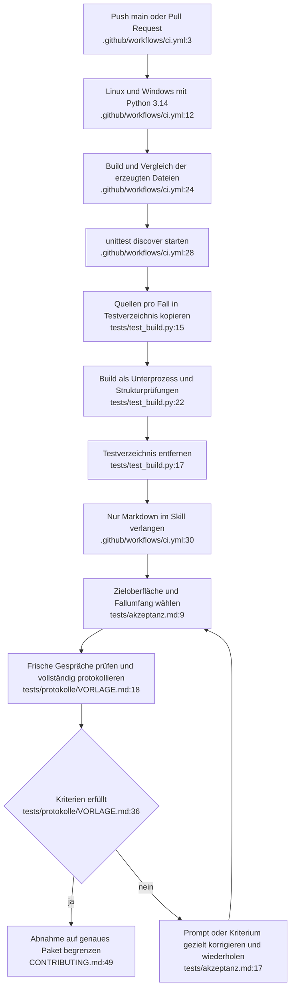

# Strukturprüfung und Plattformabnahme: Ist-Zustand

Die bestehenden neun Strukturtests prüfen Dateien und Quellregeln. Die manuelle Abnahme prüft davon getrennt Lehrverhalten und Darstellung.



Die Modellabnahme folgt als manueller Arbeitsschritt; sie ist kein automatisierter CI-Job. Bei Promptänderungen müssen Build und Strukturtests vor dem neuen Modelllauf erneut laufen.

## Konkrete Prüfpunkte

`BuildTests.setUp()` kopiert `build.py` und `tutor/` (`tests/test_build.py:15–20`); `build(*flags)` startet den isolierten Build (`:22–26`). Die neun Tests liegen an `:31–39`, `:41–54`, `:56–59`, `:61–67`, `:69–77`, `:79–91`, `:93–102`, `:104–109`, `:111–122`.

Sie prüfen erzeugte Dateien, elf Modi, Kursneutralität, ungültige Quellen ohne Überschreiben, 4000-Zeichen-Budget, Pflichtbefehle und Sprachen sowie Formelbeispiele. Der zweite Reproduzierbarkeitsvergleich prüft nur den zuletzt gespeicherten `kern.md`-Inhalt, nicht nochmals den Vollprompt (`:31–38`).

Tests verändern ausschließlich ihre temporären Kopien und starten lokale Pythonprozesse. Cleanup ist registriert (`:15–26`). CI braucht GitHub-Runner, Checkout/Setup-Python und Bash; die lokale Workflowversion ist älter als Remote-main. Aus dieser Untersuchung folgt keine Aussage über aktuelle GitHub-Checks.

## ChatGPT-Lücken

- Matrix und Vorlage kennen nur Claude Skill und ChatGPT Projekt (`tests/akzeptanz.md:9–13`, `tests/protokolle/VORLAGE.md:7`). Nativer ChatGPT-Skill, Aktivierung und Paketinhalt fehlen.
- Projektpfad: zehn B-Modusfälle plus G02/G03/G05/G25/G26/G28 und Darstellung vorgesehen (`tests/akzeptanz.md:12`). Kein ChatGPT-Protokoll vorhanden.
- D1–D3 verlangen sichtbare Formeln, Dezimalkomma und RTL; D4 ist informativ. Kein 🔒-Titel ersetzt Zurückhalten der Lösung (`tests/akzeptanz.md:103–112`, `tutor/SKILL.md:51–54`).
- Vorhandener Claude-CLI-Ersatzlauf: 16 von 62 Fällen, drei nicht bestanden, kein Gate und keine Darstellungsprüfung (`tests/protokolle/2026-10-15-claude-code-cli.md:1–47`, `:1506–1523`). Die älteren pauschalen Aussagen „nicht ausgeführt“ in README/Akzeptanzdokument sind deshalb zu präzisieren, ohne eine Zieloberflächenabnahme zu behaupten.

## Aktuelle Verifikation

Am 15.10.2026 im Elternauftrag ausgeführt:

```powershell
python -B -m unittest discover -s tests -v
```

Ergebnis: **9 Tests, OK**, 1,230 Sekunden. Der Reproduzierbarkeitstest baut isoliert und vergleicht mit `dist/`. Keine Verhaltens- oder UI-Prüfung daraus ableiten.

Gelesen: `tests/test_build.py:1–126`, `build.py:1–58`, lokale `.github/workflows/ci.yml:1–34`, `tests/akzeptanz.md:1–112`, `tests/protokolle/VORLAGE.md:1–36`, CLI-Protokoll `:1–125`, `:1506–1523`, README/CONTRIBUTING an den oben genannten Stellen. Konfidenz hoch für lokalen Prüfpfad; tatsächliche ChatGPT-Installation und Rendering bleiben offen.
