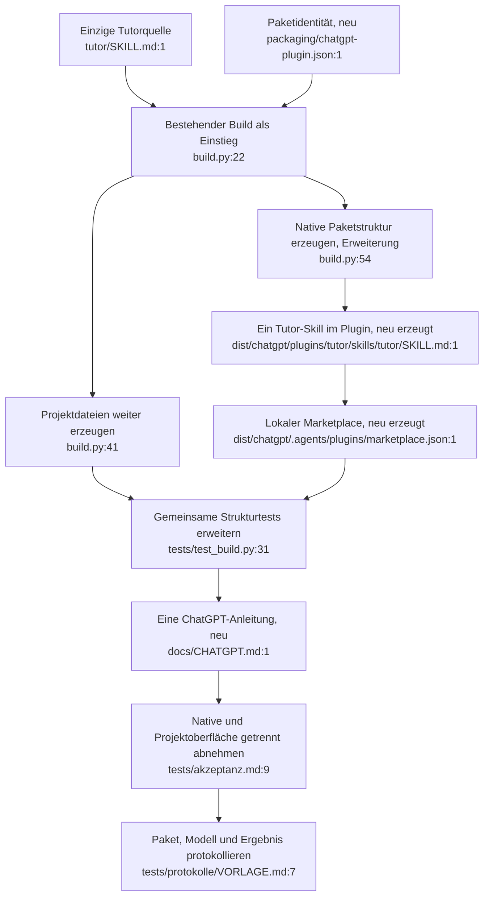

# Vorschlag: ein Tutor, native ChatGPT-Bereitstellung und Projektpfad

**Empfehlung:** `tutor/` als einzige Verhaltensquelle behalten. Den bestehenden Build um eine kleine, serverlose ChatGPT-Verpackung ergänzen und diese auf der Zieloberfläche prüfen. Kein API-Dienst und keine neue Agenten-Engine nötig. Der Tutor ist bereits ein Lern-Agent in Form von Anweisungen, nicht ein selbstständig laufendes Programm (`GLOSSARY.md:13–26`, `tutor/SKILL.md:14–18`).

Dies ist die Pathfinder-Planung, noch keine implementierte Ausgabe. Der aufgerufene Skill „pathfinder“ verlangt „You do not write implementation code.“

## 1. Gemeinsames Tutorverhalten

**Komponente:** vorhandener Tutor. **Eintritt:** `tutor/SKILL.md`.

Die tatsächliche Divergenz aus `02-duplication-report.md` wird an ihrer Quelle geklärt: Der Router erlaubt neben Tags und `!sprache` ausdrücklich die natürlichen Sprachsignale aus der Sprachreferenz. Die Referenz bleibt die vollständige Signalliste; der Kern enthält eine kurze verständliche Zusammenfassung. Die bestehende Signalmenge wird nicht eingeschränkt.

| Bisherige Stelle | Ziel |
|---|---|
| `tutor/SKILL.md:15`: verkürzte, potenziell ausschließende Aufzählung | Kurzer, zur Referenz passender Signalsatz innerhalb der bestehenden Kernmarkierung |
| `tutor/references/sprache.md:7–12` | Vollständige Signaldefinition erhalten |
| `build.py:41`, `:44–50` | Unverändert aus der gemeinsamen Quelle erzeugen; Kernbudget prüfen |
| `tests/akzeptanz.md:57–64`, `:87` | Tags und natürliche Sprachwünsche gegen dieselbe Regel beobachten |

Kein Verlust an Funktionen vorgesehen. Änderungen an zentralen Quellen erfordern die bestehende vollständige Wiederholungsregel (`tests/akzeptanz.md:17`); ein kleiner ChatGPT-Probelauf ersetzt diese Releaseabnahme nicht.

## 2. Native Bereitstellung ohne zweite Tutorquelle

**Komponente:** vorhandener Build. **Eintritt:** `python build.py`.

Die aktuelle [OpenAI-Anleitung zum Skillbau](https://learn.chatgpt.com/docs/build-skills) unterscheidet lokale eigenständige Skills und die Plugin-Verteilung über ChatGPT-Oberflächen. Daher ist ein Plugin mit genau einem enthaltenen Tutor-Skill das Ziel für die native Verteilung. `@` dient in ChatGPT zur expliziten Auswahl; automatische Auswahl gesondert testen.

Der [Paketleitfaden](https://developers.openai.com/plugins/build/plugins) beschreibt `plugin.json` am Paketroot, `skills/<name>/` und die lokale Marketplace-Verteilung. Für diesen Tutor genügen Anweisungen und Ressourcen; [ein MCP-Server ist dafür nicht erforderlich](https://developers.openai.com/plugins/build/skills).

Vorgeschlagene, vollständig erzeugte Ausgabe:

```text
packaging/chatgpt-plugin.json       # kleine gepflegte Paketidentität, keine Lernregeln
dist/chatgpt/                      # erzeugte lokale Marketplace-Wurzel
  .agents/plugins/marketplace.json  # genau ein lokaler Eintrag
  plugins/tutor/
    plugin.json
    LICENSE
    skills/tutor/
      SKILL.md
      modes/*.md
      references/*.md
dist/kern.md                       # bestehender Projektpfad
dist/system-prompt.md              # bestehender Projektpfad
```

Das Manifest enthält nur die notwendige Identität/Beschreibung nach aktueller Spezifikation. Der Build nutzt die bereits bekannten Quelldateien (`build.py:22–30`) statt rekursiv beliebige lokale Dateien einzupacken. Der modulare Inhalt bleibt bytegleich zur Quelle. Keine lokalen Werkzeugzustände, Kurspakete, Fotos oder fremden Unterlagen in das Paket aufnehmen. MIT-Hinweis aus `LICENSE` mitgeben.

Die erzeugte lokale Marketplace-Wurzel ermöglicht den dokumentierten lokalen Testweg. Kontozugriff und Unterstützung dieser Route müssen beim Installieren sichtbar bestätigt werden; ein GitHub-Release allein installiert keinen ChatGPT-Skill. Öffentliche Verzeichnisveröffentlichung und Workspace-Freigabe gehören nicht zu dieser minimalen Umsetzung.

| Bestehender Einstieg | Änderung |
|---|---|
| `build.py:54–58` | Nach erfolgreicher Quellen-/Manifestprüfung zusätzlich natives Paket ausgeben; Fehler dürfen keine scheinbar gültige Teil-Ausgabe hinterlassen |
| `tests/test_build.py:15–20` | Paketmetadaten und Lizenz in die isolierte Testkopie aufnehmen |
| `CONTRIBUTING.md:36–50` | Reproduzierbaren Paketpfad und Prüfsummen ergänzen, bestehendes Claude-ZIP erhalten |
| Remote-main `README.md:15–21`, `:82–89` | Native ChatGPT-Variante aufnehmen, auf eine genaue Anleitung `docs/CHATGPT.md` verlinken |
| Remote-main `docs/index.html:394–397` | Kurze Auswahl zwischen nativem Skill und Projektpfad, Link auf dieselbe Anleitung |
| `CLAUDE.md:3–12`, `GLOSSARY.md:17–26`, `CHANGELOG.md` | Plattformneutrale Quelle und neue erzeugte Ausgabe korrekt benennen |

Der vorhandene Projektpfad bleibt mit seinen bisherigen Dateinamen nutzbar: Kern als Projektanweisung, System-Prompt als Projektdatei. Er ist eine eigene Bereitstellungsart und muss separat getestet werden. Das interne 4000-Zeichen-Budget nicht als offizielle Plattformgrenze ausgeben.

Kein Funktionsverlust vorgesehen. Bewusst ausgelassen: neue Web-App, API-Schlüssel, MCP, Hooks, Mehragentensystem, automatische Veröffentlichung, globale Konfigurationsänderungen und weitere Plattformumbauten.

## 3. Ein Prüfverfahren, getrennte Oberflächenbelege

**Komponente:** vorhandene Tests und Akzeptanzmatrix. **Eintritt:** `python -B -m unittest discover -s tests -v`, danach Zieloberflächenlauf.

- Struktur: Manifest lesbar und notwendige Felder gültig; exakt erwartete Paketdateien; Inhalt aller 16 Skilldateien identisch zur Quelle; kein Kurspaket oder Werkzeugzustand; beide bisherigen Markdown-Ausgaben erhalten und wiederholbar; native Ausgabe wiederholbar und keine veralteten Dateien nach Quellenänderungen.
- Regression: Der bestehende zweite Buildvergleich prüft künftig beide Markdown-Dateien (`tests/test_build.py:31–38`). Ungültige Metadaten/fehlende Quellen müssen vor Veröffentlichung neuer Ausgaben scheitern, auch mit `-O`. Vorhandene Tests und Fehlermeldungen erhalten.
- Matrix/Protokoll: native ChatGPT-Route neben Projekt aufnehmen (`tests/akzeptanz.md:9–13`, `tests/protokolle/VORLAGE.md:7–12`). Modellname, Oberfläche, Commit und Hash des tatsächlich installierten Pakets angeben.
- Aktivierung: explizit `@tutor`, indirekte passende Aufgabe, unpassende Lernkartenanfrage, unvollständige Eingabe. Danach mindestens die vorhandenen zehn B-Modusfälle und G02/G03/G05/G25/G26/G28; zusätzlich Lösungsschutz G13, Urdu G29 und Auswahlfrage G32, natürliche Sprachsignale sowie D1–D3. Erster Lauf bleibt ein begrenzter Kompatibilitätsbeleg, keine vollständige Releaseabnahme.
- Bekannte CLI-Befunde und offene Fälle erhalten; niemals als ChatGPT-Ergebnis umetikettieren. Nach einer zentralen Verhaltensänderung die vorhandenen vollständigen Release-Gates weiter erfüllen.

Die aktuelle Ausgangsbasis besteht die neun Strukturtests (`01-flowcharts/pruefung.md`). Konto-/UI-Verfügbarkeit, Aktivierung, Bildlesen, Formeldarstellung, RTL und tatsächlicher Lösungsschutz sind noch nicht durch einen ChatGPT-Lauf belegt.

## Zusammengeführter Zielablauf

Neue Pfade sind geplante Dateien; `:1` bezeichnet deren vorgesehenen Einstieg, keine existierende Implementierungszeile.


